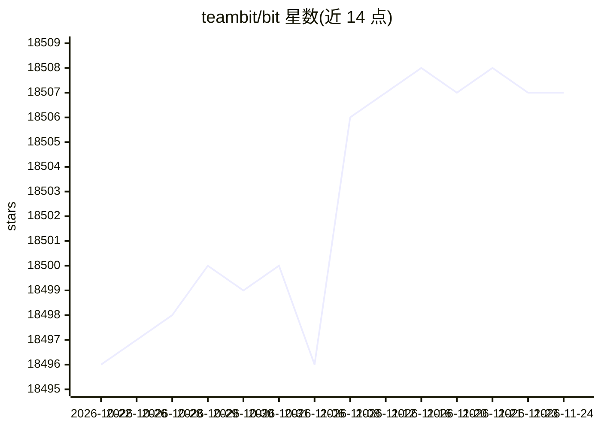

# teambit/bit

⭐ 18,507 · TypeScript · NOASSERTION · 推送 2026-11-22 · [GitHub](https://github.com/teambit/bit) · [官网](https://bit.dev) · 组织维护

**给开发者的组件化构建系统，供人与 AI agent 复用组件**

Bit 是一个把源代码组织为可组合组件的构建系统，覆盖从开发到 CI 的流程：创建可复用的 UI 组件与模块、组装应用壳、语义化版本管理、通过 Ripple CI 或本地构建发布，并可用标准包管理器安装已构建组件。支持 monorepo、polyrepo 或无仓库结构，内置 NodeJS、React、Angular、Vue、NextJS 等官方开发环境，原生支持 TypeScript 与 ESM。通过 MCP 使 AI agent 能创建和复用组件。提供 Bit Cloud 托管 scope，也可自行托管。

## 筛选速览

| 维度 | 判定 | 备注 |
|---|---|---|
| AI 角色 | `ai-ecosystem` | LLM/agent 周边工具 |
| 许可风险 | `none` | NOASSERTION |
| 部署形态 | `library` | 以包/库形式分发 |
| 模型依赖 | — | README 未给出锁定关系 |
| 硬件要求 | — | 无带数字的原话,不猜 |
| 安装摩擦 | `low` | 无编译、无系统依赖或容器化 |
| 成熟度 | — | 结构信号不足 |

## 动量与使用信号

- 维护:`active` — 距上次 push 1.4 天,年发版 8,74 位贡献者
- 涨星:近 1 天 **+1**(自 20261016 起算)
- 安装:npm 包 `@my-org/users.pages.login` 月下载无数据
- 平台:— · 协议:MCP

## 能力要点

- 将源码组织为可组合组件，支持 monorepo/polyrepo/无仓库结构
- 通过 MCP 支持 AI agent 创建与复用组件
- 内置 NodeJS/React/Angular/Vue/React Native/NextJS 官方开发环境
- 组件可用标准包管理器（npm install）安装使用

## 适用场景

- 在 monorepo 中管理可复用的前端组件与模块
- 让 AI agent 复用已有组件避免重复开发
- 将组件构建发布后供团队通过 npm 安装

## 场景标签

 · 领域:前端/软件工程工具链

## 证据(README 行号)

> L12: Bit is the build system to connect components and apps from development to CI in the AI era. Bit organizes source c
> L21: Bit supports all tooling in the JS ecosystem and comes out of the box with official dev environments for NodeJS, Re

## 星数曲线

2026-10-22 18,496 → 2026-11-24 18,507（+11）

---
*卡片 v1 · prompt 1.4 · 生成 2026-11-22 · 置信度 high · 依据 README sha `50900824114a` · [字段定义](../../DATASET.md)*
