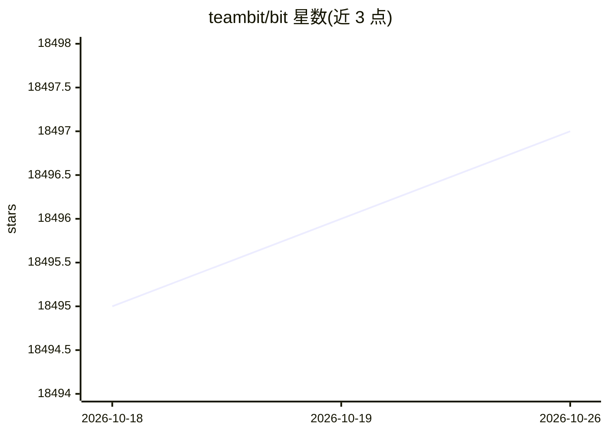

# teambit/bit

⭐ 18,497 · TypeScript · NOASSERTION · 推送 2026-10-25 · [GitHub](https://github.com/teambit/bit) · [官网](https://bit.dev) · 组织维护

**为开发者提供组件化代码构建系统并让 AI agent 复用组件**

Bit 是一个连接组件与应用、覆盖开发到 CI 的构建系统：将源码组织为可组合的组件，支持创建可复用 UI 组件、定义组件蓝图模板、组合应用外壳、部署应用与服务。通过 MCP 让 AI agent 创建和复用组件。支持 monorepo、polyrepo 或无仓库结构，提供 NodeJS、React、Angular、Vue、React Native、NextJS 等官方开发环境，原生支持 TypeScript 与 ESM。通过 npx 安装器装到 PATH，组件可通过标准包管理器安装；托管 scope 需使用 Bit Cloud 或自托管。

## 筛选速览

| 维度 | 判定 | 备注 |
|---|---|---|
| AI 角色 | `ai-enhanced` | 去掉 AI 部分产品仍成立 |
| 许可风险 | `none` | NOASSERTION |
| 部署形态 | `library` | 以包/库形式分发 |
| 模型依赖 | — | README 未给出锁定关系 |
| 硬件要求 | — | 无带数字的原话,不猜 |
| 安装摩擦 | `low` | 无编译、无系统依赖或容器化 |
| 成熟度 | — | 结构信号不足 |

## 动量与使用信号

- 维护:`active` — 距上次 push 1.4 天,年发版 8,74 位贡献者
- 涨星:近 1 天 **+1**(自 20261016 起算)
- 安装:npm 包 `@my-org/users.pages.login` 月下载无数据
- 平台:— · 协议:MCP

## 能力要点

- 通过 MCP 使 AI agent 能创建和复用组件
- 提供 NodeJS、React、Angular、Vue、React Native、NextJS 等官方开发环境
- 支持 monorepo、polyrepo 或无仓库的代码结构
- 组件可用 npm 等标准包管理器安装

## 适用场景

- 在 monorepo 或多仓库中管理可复用的 UI 组件与模块
- 组合可复用组件构建应用外壳并部署
- 让 AI agent 在开发流程中复用已有组件避免重复创建

## 场景标签

 · 领域:软件开发工具/前端工程

## 证据(README 行号)

> L12: Bit is the build system to connect components and apps from development to CI in the AI era. Bit organizes source c
> L21: Bit supports all tooling in the JS ecosystem and comes out of the box with official dev environments for NodeJS, Re

## 星数曲线

2026-10-18 18,495 → 2026-10-26 18,497（+2）

---
*卡片 v1 · prompt 1.4 · 生成 2026-10-18 · 置信度 high · 依据 README sha `5b6e896c9ed9` · [字段定义](../../DATASET.md)*
