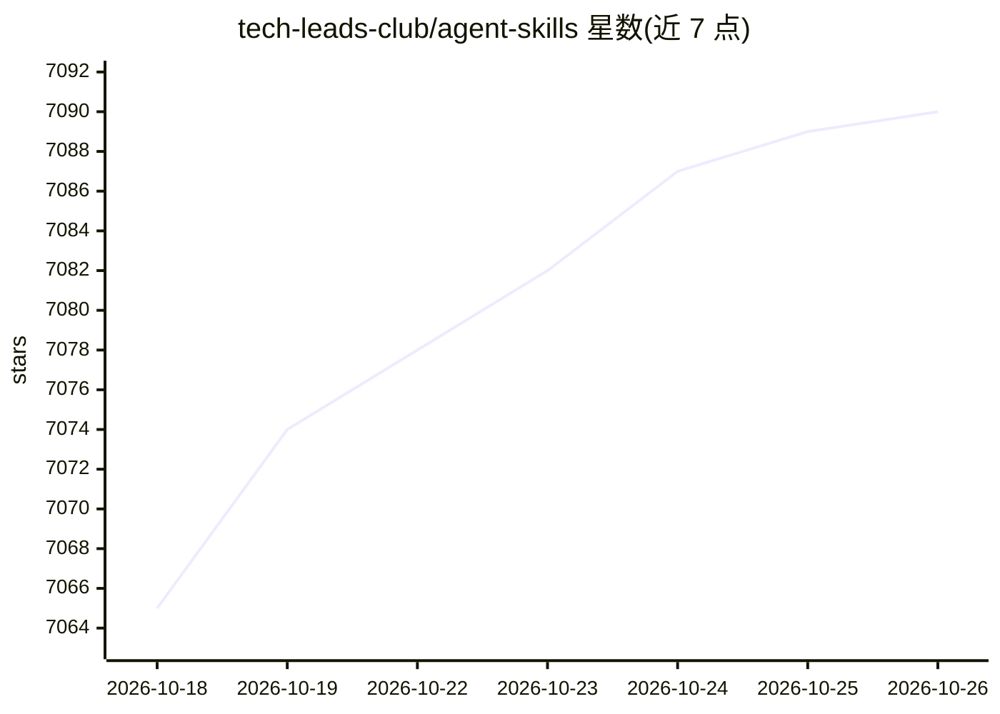

# tech-leads-club/agent-skills

⭐ 7,090 · TypeScript · NOASSERTION · 推送 2026-10-25 · [GitHub](https://github.com/tech-leads-club/agent-skills) · [官网](https://agent-skills.techleads.club) · 组织维护

**面向 AI 编程 agent 的安全校验技能注册库与安装 CLI**

由 Tech Leads Club 社区维护的 agent 技能注册库：收录经人工筛选与扫描（CI/CD 静态分析、内容哈希与 lockfile 完整性、Snyk Agent Scan）的 SKILL.md 格式技能，供开发者在 Claude Code、Cursor、Copilot、Windsurf 等 20 余种 AI 编程 agent 中安装使用。提供 npx 交互式 CLI（复制或符号链接、全局或项目级安装，技能按需从 CDN 下载并本地缓存）以及暴露技能目录的 MCP 服务器（list/search/read/fetch 四个工具）。技能含开发流程、AWS 顾问、Playwright 自动化、Figma 转代码、安全审查等类别。引擎代码 MIT，维护者技能 CC-BY-4.0，使用须署名。

## 筛选速览

| 维度 | 判定 | 备注 |
|---|---|---|
| AI 角色 | `ai-knowledge` | 知识聚合/清单类 |
| 许可风险 | `none` | NOASSERTION |
| 部署形态 | `library` | 以包/库形式分发 |
| 模型依赖 | — | README 未给出锁定关系 |
| 硬件要求 | — | 无带数字的原话,不猜 |
| 安装摩擦 | `low` | 无编译、无系统依赖或容器化 |
| 成熟度 | — | 结构信号不足 |

## 能力要点

- npx 交互式 CLI 浏览/选择/安装技能到目标 agent
- MCP 服务器以渐进披露方式暴露技能目录（搜索后按需获取）
- 安全机制：静态分析、内容哈希与 lockfile 完整性、路径隔离、发布前扫描
- 支持 Claude Code、Cursor、Copilot、Windsurf 等 20 余种 agent

## 适用场景

- 给我的 Cursor/Claude Code 安装经验证的扩展技能
- 通过 MCP 让 agent 按需检索和加载技能
- 避开未经校验的开放市场技能带来的安全风险

## 场景标签

`精选清单` `提示工程` · 领域:Agent 开发

## 证据(README 行号)

> L21:  The secure, validated skill registry for professional AI coding agents
> L35: Skills are packaged instructions and resources that extend AI agent capabilities. Think of them as **plugins for yo

## 星数曲线

2026-10-18 7,065 → 2026-10-26 7,090（+25）

---
*卡片 v1 · prompt 1.4 · 生成 2026-10-20 · 置信度 high · 依据 README sha `47509cc417f0` · [字段定义](../../DATASET.md)*
