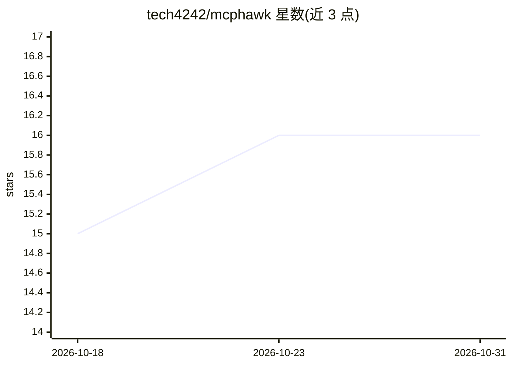

# tech4242/mcphawk

⭐ 16 · Python · MIT · 推送 2026-09-23 · [GitHub](https://github.com/tech4242/mcphawk) · 个人维护

**MCP 流量录制与调试工具：像浏览器网络面板查看 agent 调用**

面向 Model Context Protocol 的开发者工具，通过 stdio 包装、HTTP 代理或被动嗅探三种方式录制 MCP 客户端（Claude Code/Claude Desktop/Cursor/VS Code）与其服务器之间的真实流量，在 Web UI 中按 agent run 时间线展示每次调用的耗时、结果与失败情况。提供单调用检查与重放、每工具上下文 token 成本估算、按协议版本的规范违规检查、会话版本对比，以及 OpenTelemetry（OTLP）导出到 Grafana/Datadog 等。本身也是一个 MCP 服务器，agent 可查询流量数据。数据存于本地 SQLite，敏感信息存储前打码。pip 安装，MIT 许可。

## 筛选速览

| 维度 | 判定 | 备注 |
|---|---|---|
| AI 角色 | `ai-ecosystem` | LLM/agent 周边工具 |
| 许可风险 | `permissive` | MIT |
| 部署形态 | `self-host` | docker 或自建部署 |
| 模型依赖 | — | README 未给出锁定关系 |
| 硬件要求 | — | 无带数字的原话,不猜 |
| 安装摩擦 | `low` | 无编译、无系统依赖或容器化 |
| 成熟度 | — | 结构信号不足 |

## 能力要点

- Wrap/Proxy/Sniff 三种流量捕获模式，一条命令接入主流 MCP 客户端
- agent run 时间线：一次任务跨所有 MCP 服务器的调用瀑布图
- 上下文成本估算：每服务器/每工具每回合增加的 token 数
- 以 OpenTelemetry metrics/logs/traces 输出到任意 OTLP 后端

## 适用场景

- 调试 agent 对 MCP 服务器的调用失败与延迟问题
- 评估各 MCP 服务器工具定义占用多少上下文窗口
- 对比服务器两个版本之间的工具变更与调用表现
- 让 agent 自己读取流量记录协助排障

## 场景标签

`LLM 可观测性` · 领域:评测与运维

## 证据(README 行号)

> L10: **MCPHawk is DevTools for the Model Context Protocol.** It records the real traffic
> L114: MCPHawk streams what it records as OpenTelemetry **metrics, logs and traces** over OTLP,
> L145: MCPHawk is an MCP server too. Your agent can list runs, read a failing call, check context

## 星数曲线

2026-10-18 15 → 2026-10-31 16（+1）

---
*卡片 v1 · prompt 1.4 · 生成 2026-10-30 · 置信度 mid · 依据 README sha `64361308d1e0` · [字段定义](../../DATASET.md)*
