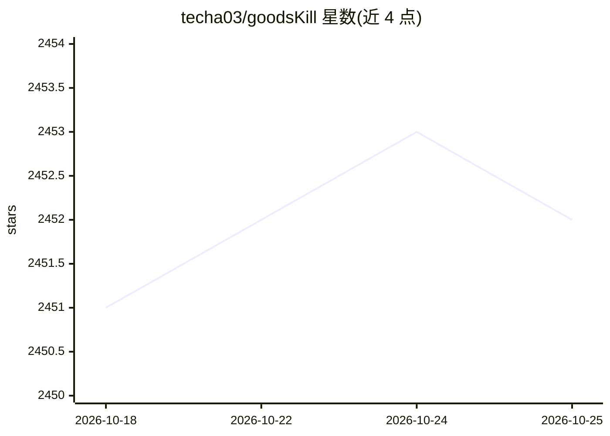

# techa03/goodsKill

⭐ 2,452 · Java · MIT · 推送 2026-10-24 · [GitHub](https://github.com/techa03/goodsKill) · 个人维护 · 中文 README

**面向后端学习者的 SpringCloud 微服务模拟秒杀项目**

基于 Spring Cloud 2025.x + Spring Boot 4.x + JDK21 + Dubbo 3.x 构建的模拟秒杀微服务项目，提供统一秒杀模拟请求接口与 10 种秒杀方案实现（同步锁、Redisson 分布式锁、Kafka、ZooKeeper、Sentinel 限流等），集成分库分表（Sharding-JDBC）、分布式事务（Seata）、Spring Statemachine 状态机与 OpenTelemetry 全链路可观测性。含 Vue 3 管理端与 C 端商城前端。AI 部分为基于 Spring AI Alibaba 的机器人服务，可开启秒杀活动、输出耗时与知识库问答。README 声明省略真实场景细节、框架版本较新未经完整测试，仅作学习参考。

## 筛选速览

| 维度 | 判定 | 备注 |
|---|---|---|
| AI 角色 | `ai-enhanced` | 去掉 AI 部分产品仍成立 |
| 许可风险 | `permissive` | MIT |
| 部署形态 | `self-host` | docker 或自建部署 |
| 模型依赖 | — | README 未给出锁定关系 |
| 硬件要求 | — | 无带数字的原话,不猜 |
| 安装摩擦 | `low` | 无编译、无系统依赖或容器化 |
| 成熟度 | `idea` | |

## 能力要点

- 10 种秒杀方案实现并通过 SeckillMockController 提供测试接口
- Spring AI Alibaba 机器人服务：开启秒杀活动、耗时输出、知识库问答
- Sharding-JDBC 分库分表 + Seata 分布式事务 + Spring Statemachine 状态机
- OpenTelemetry + Grafana LGTM 全链路可观测性

## 适用场景

- 学习微服务秒杀方案的多种实现与对比
- 参考 Spring Cloud 2025.x + Dubbo 3.x + JDK21 技术栈搭建
- 通过 AI 机器人对话触发秒杀模拟与服务调用

## 场景标签

`教程课程` · 领域:学习与行业

## 证据(README 行号)

> L10: 本项目为模拟秒杀项目，提供统一秒杀模拟请求接口，技术上整体采用SpringMVC + Mybatis持久层框架，采用Dubbo3.x+原生RestClient完成服务间接口调用，服务注册发现以及配置中心使用Nacos，支持数据库分
> L12: 集成了Spring AI服务，可以通过AI机器人完成模拟秒杀动作。
> L16: 本项目基于最新Spring Cloud 2025.x + Spring Boot 4.x + JDK21体系构建，目前比较简陋且有很多不完善的地方，真实的秒杀场景远比本项目中的实现方式复杂，本项目省略了真实场景中的部分技术实现细节

## 星数曲线

2026-10-18 2,451 → 2026-10-25 2,452（+1）

---
*卡片 v1 · prompt 1.4 · 生成 2026-10-21 · 置信度 mid · 依据 README sha `8290d823a10f` · [字段定义](../../DATASET.md)*
