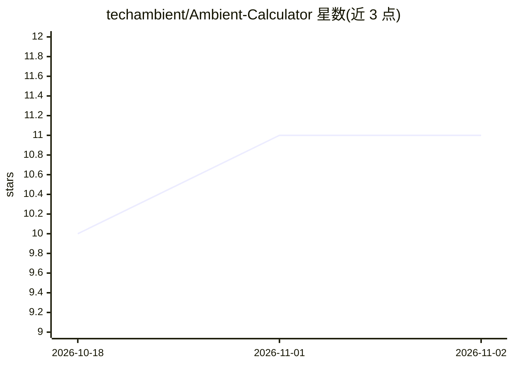

# techambient/Ambient-Calculator

⭐ 11 · Kotlin · MIT · 推送 2026-10-31 · [GitHub](https://github.com/techambient/Ambient-Calculator) · [官网](https://www.youtube.com/@techambient) · 个人维护

**Android 离线 AI 计算器：OCR 识别算式并出结果**

面向 Android 手机、平板与折叠屏的开源计算器应用，用 Kotlin 编写并采用 Material 3 / Material You 主题。核心功能包括科学计算、历史记录、Business 模式、双面板平板布局、快捷设置磁贴与桌面小部件。AI 相关能力为离线的算式转结果 OCR，以及预览版手写算式转数学；Minimal 版本体积约 1.8MB，无需权限且 100% 离线，OCR 功能需相机权限并在 Full 版本提供。

## 筛选速览

| 维度 | 判定 | 备注 |
|---|---|---|
| AI 角色 | `ai-enhanced` | 去掉 AI 部分产品仍成立 |
| 许可风险 | `permissive` | MIT |
| 部署形态 | `None` |  |
| 模型依赖 | — | README 未给出锁定关系 |
| 硬件要求 | — | 无带数字的原话,不猜 |
| 安装摩擦 | `low` | 无编译、无系统依赖或容器化 |
| 成熟度 | — | 结构信号不足 |

## 能力要点

- 离线 math-to-result OCR 与预览版手写转算式
- Minimal 版仅约 1.8MB、零广告零追踪、100% 离线
- 针对手机单面板与平板双面板的界面适配

## 适用场景

- 在手机或平板上做科学计算并保留历史记录
- 拍照/手写算式离线识别出结果（Full 版）
- 追求小体积、无广告无追踪的计算器

## 场景标签

`OCR` · 领域:感知与多模态

## 证据(README 行号)

> L16: * None permissions required for Minimal version, Camera required for OCR (Full version)
> L17: * Offline AI powered math to result OCR

## 星数曲线

2026-10-18 10 → 2026-11-02 11（+1）

---
*卡片 v1 · prompt 1.4 · 生成 2026-11-01 · 置信度 high · 依据 README sha `f9fa76782df4` · [字段定义](../../DATASET.md)*
