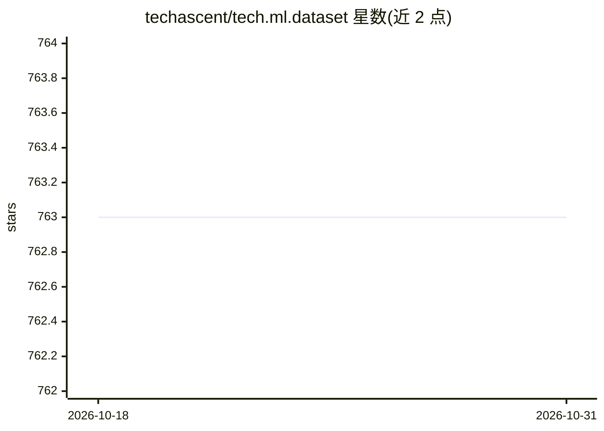

# techascent/tech.ml.dataset

⭐ 763 · Clojure · EPL-1.0 · 推送 2026-10-02 · [GitHub](https://github.com/techascent/tech.ml.dataset) · 组织维护

**Clojure 表格数据处理库：JVM 上的列式数据集与 ETL**

面向 Clojure/JVM 开发者的表格数据处理库，功能定位类似 Python 的 Pandas 或 R 的 data.table：读取与处理 CSV、xlsx 等表格数据，支持 ETL 式数据流水线。数据集采用列式存储、原生类型数组、紧凑 datetime 与字符串表以减少内存占用；与 Python/R 不同，数据集为函数式（不可变）设计。通过 Clojars 安装，提供完整 API 文档、Java API 与示例程序。回归/分类机器学习路径由独立的 tech.ml 提供。

## 筛选速览

| 维度 | 判定 | 备注 |
|---|---|---|
| AI 角色 | `ai-enhanced` | 去掉 AI 部分产品仍成立 |
| 许可风险 | `viral` | EPL-1.0 |
| 部署形态 | `None` |  |
| 模型依赖 | — | README 未给出锁定关系 |
| 硬件要求 | — | 无带数字的原话,不猜 |
| 安装摩擦 | `low` | 无编译、无系统依赖或容器化 |
| 成熟度 | — | 结构信号不足 |

## 能力要点

- 列式存储与原生类型数组实现内存缩减
- 函数式（不可变）数据集设计
- 提供 Java API 与示例程序，可从 Java 使用
- 独立基准测试对比性能

## 适用场景

- 在 Clojure 中做 CSV/xlsx 数据清洗与 ETL 处理
- JVM 数据科学工作流中的表格数据处理
- 从 Java 调用列式数据处理能力

## 场景标签

 · 领域:数据处理/数据科学

## 证据(README 行号)

> L9: `tech.ml.dataset` (TMD) is a Clojure library for tabular data processing similar to Python's Pandas, or R's `data.ta
> L52: * Simple regression/classification machine learning pathways are available in tech.ml.

## 星数曲线

2026-10-18 763 → 2026-10-31 763（+0）

---
*卡片 v1 · prompt 1.4 · 生成 2026-10-21 · 置信度 high · 依据 README sha `c24d62f6676c` · [字段定义](../../DATASET.md)*
