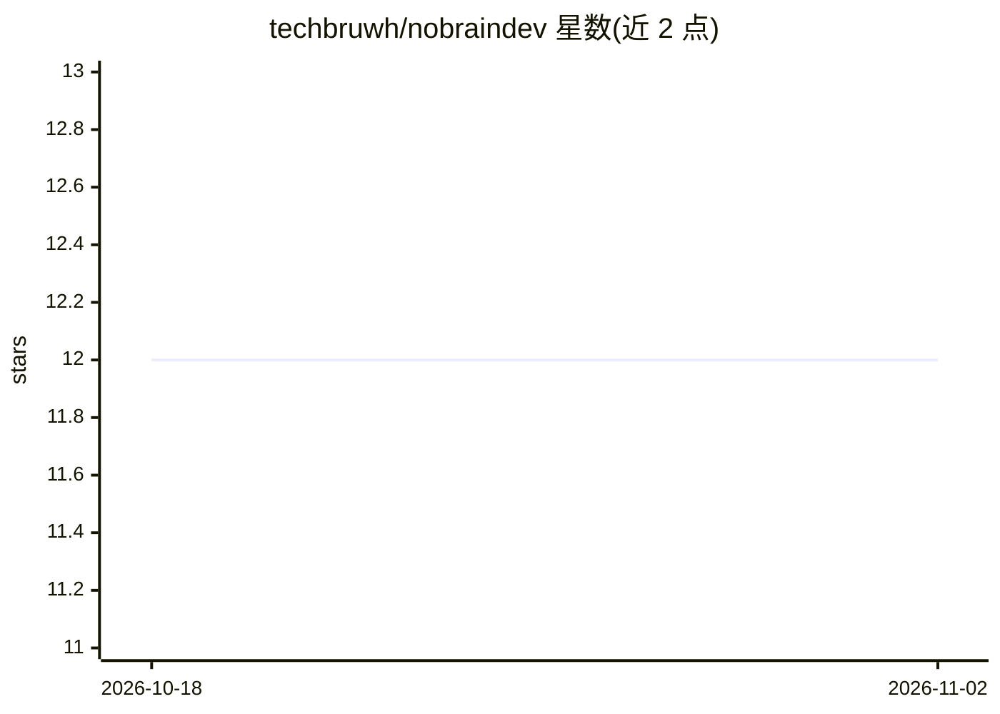

# techbruwh/nobraindev

⭐ 12 · JavaScript · 推送 2026-01-23 · [GitHub](https://github.com/techbruwh/nobraindev) · 个人维护

**离线优先的笔记与剪贴板管理桌面应用（Rust）**

用 Rust 和 Tauri 构建的桌面应用，本地管理代码片段与剪贴板历史，数据存储于本地 SQLite。提供关键词搜索（按标题/标签/内容过滤）以及基于小型语言模型（SLM）的 AI 语义搜索，支持自然语言检索。默认离线可用，可选云同步（Supabase）。界面用 React、Tailwind CSS 与 shadcn/ui 构建。README 仅给出 macOS 的 Homebrew 安装方式。

## 筛选速览

| 维度 | 判定 | 备注 |
|---|---|---|
| AI 角色 | `ai-enhanced` | 去掉 AI 部分产品仍成立 |
| 许可风险 | `none` | — |
| 部署形态 | `None` |  |
| 模型依赖 | — | README 未给出锁定关系 |
| 硬件要求 | — | 无带数字的原话,不猜 |
| 安装摩擦 | `low` | 无编译、无系统依赖或容器化 |
| 成熟度 | — | 结构信号不足 |

## 能力要点

- 本地片段与剪贴板管理，数据存储于 SQLite
- 基于小型语言模型（SLM）的 AI 自然语言语义搜索
- 离线优先设计，联网时可选云同步

## 适用场景

- 本地保存并检索常用代码片段
- 查看和搜索剪贴板历史
- 离线环境下用自然语言搜索笔记内容

## 场景标签

`知识库管理` `语义搜索` · 领域:知识与检索

## 证据(README 行号)

> L5:  ### A powerful, tiny, offline-first, AI-powered desktop application for managing notes and clipboard written in Rus
> L15: - **AI Semantic Search** - Natural language search powered by Small Language Models (SLM)

## 星数曲线

2026-10-18 12 → 2026-11-02 12（+0）

---
*卡片 v1 · prompt 1.4 · 生成 2026-10-31 · 置信度 high · 依据 README sha `046995ba6dd9` · [字段定义](../../DATASET.md)*
