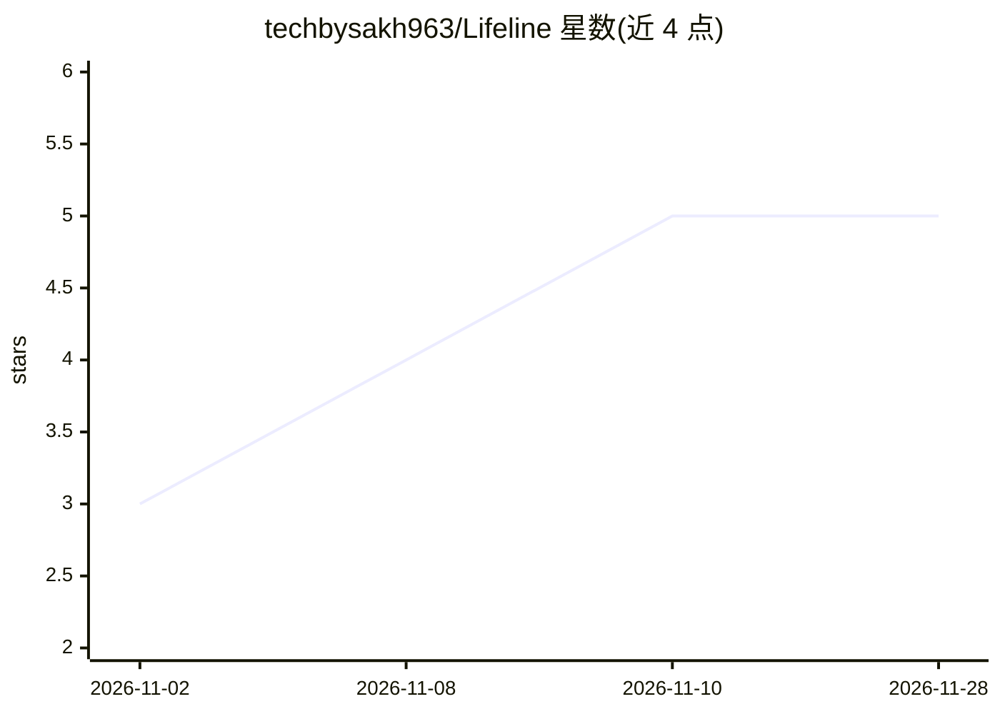

# techbysakh963/Lifeline

⭐ 5 · Kotlin · Apache-2.0 · 推送 2026-11-01 · [GitHub](https://github.com/techbysakh963/Lifeline) · [官网](https://techbysakh963.github.io/Lifeline/) · 个人维护

**用 root 安卓手机通过 USB 修复无法启动的 PC 的 AI 急救工具**

Lifeline 是一款 Android 应用（APK 分发，Apache-2.0），把已 root 的手机变成故障电脑的救援终端：通过 USB 提供 SSH、USB 键盘（HID）和 USB 启动盘三种通道，由用户订阅的 AI（Claude/ChatGPT/Gemini CLI 或 Claude/OpenAI/Gemini/DeepSeek 的 API key）驱动诊断循环。安全机制包括 CommandPolicy 白名单分类（只读/需批准/破坏性/禁止）、破坏性操作需键入 DELETE 确认、密钥脱敏与可撤销的变更记录。目前为 beta，仅在两款手机上完整测试。

## 筛选速览

| 维度 | 判定 | 备注 |
|---|---|---|
| AI 角色 | `ai-native` | 本体是模型或模型工具 |
| 许可风险 | `permissive` | Apache-2.0 |
| 部署形态 | `None` |  |
| 模型依赖 | — | README 未给出锁定关系 |
| 硬件要求 | — | 无带数字的原话,不猜 |
| 安装摩擦 | `medium` | 含编译或系统依赖之一 |
| 成熟度 | `idea` | |

## 能力要点

- SSH、USB 键盘（HID）、USB 启动盘三种救援通道
- CommandPolicy 命令分类与破坏性操作 DELETE 确认
- 复用用户已有的 Claude/ChatGPT/Gemini 订阅 CLI，或 API key（含 DeepSeek）
- 按设备保存对话记录，支持一键撤销 Lifeline 所做变更

## 适用场景

- 电脑黑屏或进不了系统时，用手机当作 USB 键盘进行救援操作
- 通过 SSH 让 AI 在故障 Linux PC 上诊断并修复问题
- 把手机当作 USB 启动盘引导救援系统

## 场景标签

`AI 助手` · 领域:对话与助手

## 证据(README 行号)

> L3:  An AI repair kit for broken computers, on the phone in your pocket.
> L32: Sign in to the **Claude**, **ChatGPT** or **Gemini** subscription you already have. Their official command-line too
> L72:  │  AI brain ─► tool call ─► safety policy  │  SSH · USB keyboard ·    │  real commands, real logs │

## 星数曲线

2026-11-02 3 → 2026-11-28 5（+2）

---
*卡片 v1 · prompt 1.4 · 生成 2026-11-21 · 置信度 high · 依据 README sha `2344ebc95bac` · [字段定义](../../DATASET.md)*
