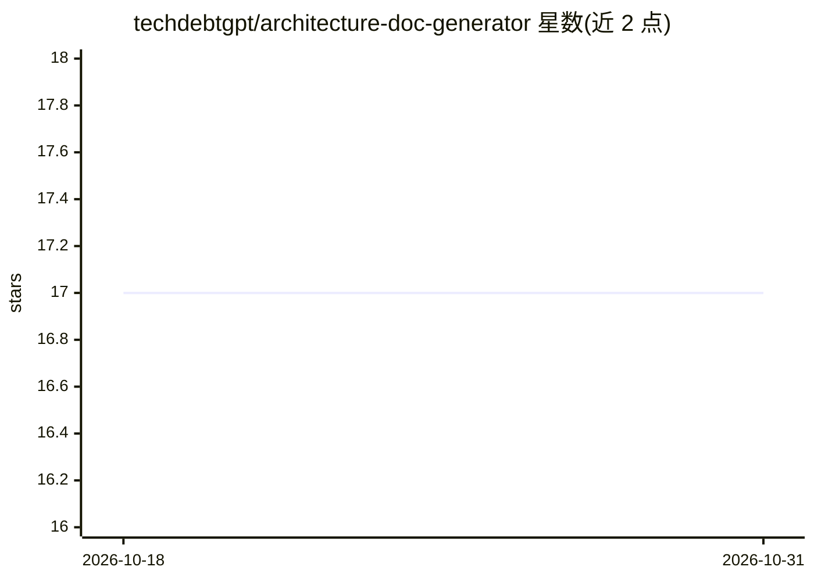

# techdebtgpt/architecture-doc-generator

⭐ 17 · TypeScript · Apache-2.0 · 推送 2026-06-13 · [GitHub](https://github.com/techdebtgpt/architecture-doc-generator) · [官网](https://www.techdebtgpt.com/) · 个人维护

**分析代码库自动生成架构文档的 AI CLI 工具**

面向开发者的 Node.js CLI：用 11 个专用 AI Agent 分析代码库的结构、依赖、模式、安全与技术债等维度，生成 Markdown 架构文档与 C4 模型。基于 LangChain/LangGraph 工作流，支持 Claude、OpenAI、Gemini、Grok 等模型；检索采用本地 TF-IDF 嵌入加依赖图的混合方式，查询可零 API 成本。增量分析按 Git 变更只处理改动文件以降低 token 消耗。npm 全局安装，支持 MCP 接入 Cursor、Claude Code、Copilot 等 AI 客户端。

## 筛选速览

| 维度 | 判定 | 备注 |
|---|---|---|
| AI 角色 | `ai-native` | 本体是模型或模型工具 |
| 许可风险 | `permissive` | Apache-2.0 |
| 部署形态 | `library` | 以包/库形式分发 |
| 模型依赖 | locked-api |  |
| 硬件要求 | — | 无带数字的原话,不猜 |
| 安装摩擦 | `low` | 无编译、无系统依赖或容器化 |
| 成熟度 | — | 结构信号不足 |

## 能力要点

- 11 个专用 Agent 覆盖结构/依赖/安全/技术债/KPI 等维度
- 本地 TF-IDF 嵌入 + 依赖图混合检索，查询零 API 成本
- Git/文件哈希增量分析，官方称节省 60-90% token 成本
- 原生 MCP 集成 Cursor、Claude Code、VS Code Copilot、Claude Desktop

## 适用场景

- 为遗留代码库自动生成可版本化的架构文档
- 用自然语言查询“支付逻辑在哪”等架构问题
- 在 Cursor/Claude Code 中把架构分析当作工具调用

## 场景标签

`AI 写作` · 领域:内容生成

## 证据(README 行号)

> L12: > 🤖 **AI-powered architecture documentation generator**
> L15: ArchDoc Generator is an intelligent tool that analyzes your codebase and generates comprehensive, accurate architec
> L30: - 🧠 **AI-Powered**: Uses LangChain with Claude 4.5, OpenAI o1/GPT-4o, Gemini 2.5, or Grok 3.

## 星数曲线

2026-10-18 17 → 2026-10-31 17（+0）

---
*卡片 v1 · prompt 1.4 · 生成 2026-10-29 · 置信度 high · 依据 README sha `668cc1a92420` · [字段定义](../../DATASET.md)*
