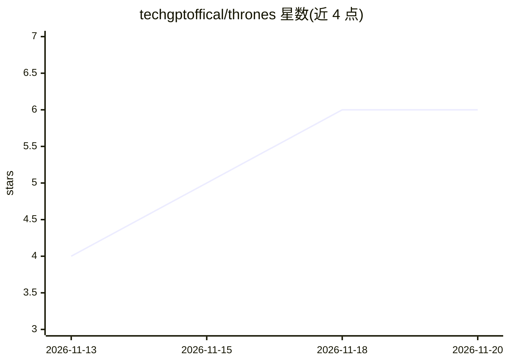

# techgptoffical/thrones

⭐ 6 · Python · NOASSERTION · 推送 2026-11-13 · [GitHub](https://github.com/techgptoffical/thrones) · [官网](https://github.com/techgptoffical/thrones/releases/latest) · 个人维护

**在个人电脑本地运行的开源模型私人 AI 助手**

面向 Windows 用户的本地 AI 助手应用，默认运行 Qwen3.5 9B 的 Q4_K_M 量化模型，由 llama.cpp 本地执行。提供 Fast/Think/Deep Research 三种模式：Think 模式用计算器校验算术并由独立验证环节复查答案；Deep Research 搜索网页并生成带真实引用链接的报告。支持 PDF/DOCX/CSV 等文档的本地索引问答（SQLite FTS5）、用户可控的记忆管理、印地语/英语/Hinglish 回答，每条回复附实测速度与内存占用。无安装包，需 Python 3.11+，可选 NVIDIA GPU。

## 筛选速览

| 维度 | 判定 | 备注 |
|---|---|---|
| AI 角色 | `ai-native` | 本体是模型或模型工具 |
| 许可风险 | `permissive` | NOASSERTION |
| 部署形态 | `desktop` | 安装包/桌面程序 |
| 模型依赖 | — | README 未给出锁定关系 |
| 硬件要求 | — | 无带数字的原话,不猜 |
| 安装摩擦 | `low` | 无编译、无系统依赖或容器化 |
| 成熟度 | `idea` | |

## 能力要点

- 完全离线聊天：本地模型流式输出，无账号无遥测
- Think 模式：启用思考 + 计算器校验 + 独立验证环节
- Deep Research 生成每个引用均指向实际抓取页面的报告
- 硬件感知：检测 GPU/RAM 自动选择 Lite/Balanced/High 配置

## 适用场景

- 断网环境下在个人电脑上进行私密 AI 对话
- 上传文档后做带页码引用的本地知识问答
- 用 Deep Research 生成带来源的网络调研报告

## 场景标签

`AI 助手` `RAG` · 领域:对话与助手

## 证据(README 行号)

> L3:  A private AI assistant that runs on your own PC.
> L19: |**Chat, fully offline**|Streaming answers from a local model. Works with the network cable unplugged. No account, 
> L20: |**Fast / Think / Deep Research**|Three modes that change what the backend actually does. *Think* plans, solves wit

## 星数曲线

2026-11-13 4 → 2026-11-20 6（+2）

---
*卡片 v1 · prompt 1.4 · 生成 2026-11-20 · 置信度 high · 依据 README sha `e8522726e921` · [字段定义](../../DATASET.md)*
