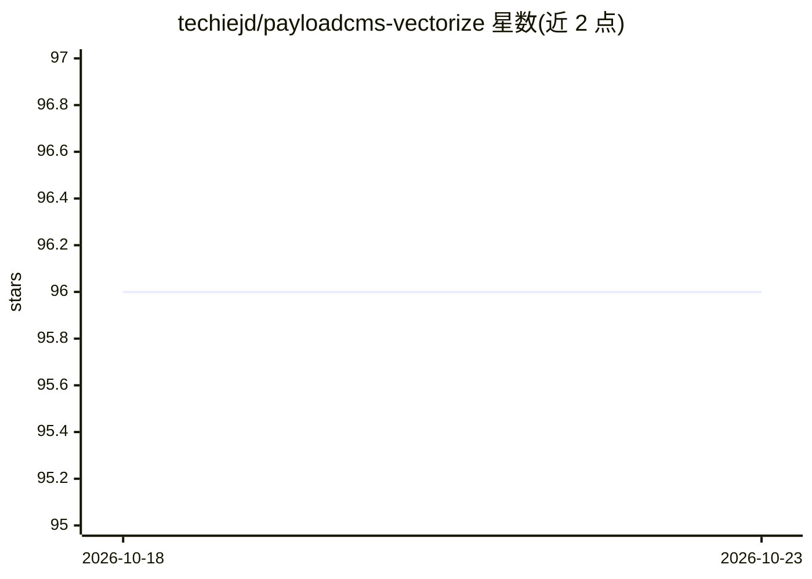

# techiejd/payloadcms-vectorize

⭐ 96 · TypeScript · MIT · 推送 2026-06-22 · [GitHub](https://github.com/techiejd/payloadcms-vectorize) · [官网](http://npmjs.com/package/payloadcms-vectorize) · 个人维护

**为 Payload CMS 3.0 集合提供向量搜索的插件，用于构建 RAG**

Payload CMS 3.x 的插件，将集合内容向量化以支持语义搜索与 RAG 应用。提供实时摄取（创建/更新时自动嵌入、删除时清理）、基于 embeddingVersion 的批量回填、可插拔数据库适配器（PostgreSQL+pgvector、Cloudflare Vectorize、MongoDB Atlas/自建 8.2+）、多知识池、本地化支持、带 where 过滤的 REST 搜索端点与可选重排序（Voyage/Cohere/本地 cross-encoder）。嵌入函数由用户自带（如 Voyage AI）。要求 Node.js 18+，通过 pnpm/npm 安装，生产构建前需运行 generate:importmap。

## 筛选速览

| 维度 | 判定 | 备注 |
|---|---|---|
| AI 角色 | `ai-ecosystem` | LLM/agent 周边工具 |
| 许可风险 | `permissive` | MIT |
| 部署形态 | `library` | 以包/库形式分发 |
| 模型依赖 | — | README 未给出锁定关系 |
| 硬件要求 | — | 无带数字的原话,不猜 |
| 安装摩擦 | `low` | 无编译、无系统依赖或容器化 |
| 成熟度 | — | 结构信号不足 |

## 能力要点

- 创建/更新自动向量化、删除自动清理嵌入的实时摄取
- 三种可插拔数据库适配器：PostgreSQL+pgvector / Cloudflare Vectorize / MongoDB
- 基于 Payload job 系统的后台批量嵌入与 embeddingVersion 增量回填
- 内置 /api/vector-search 端点，支持 Payload 风格 where 元数据过滤

## 适用场景

- 为 Payload CMS 站点内容构建语义搜索
- 以 CMS 集合为知识源搭建 RAG 应用
- 多语言（i18n）内容的嵌入与检索

## 场景标签

`RAG` `语义搜索` · 领域:知识与检索

## 证据(README 行号)

> L8: A Payload CMS plugin that adds vector search capabilities to your collections. Perfect for building RAG (Retrieval-A
> L65: The example below is **runnable as-is** — it uses Voyage AI's embedding API for `realTimeIngestionFn` / `queryFn` a

## 星数曲线

2026-10-18 96 → 2026-10-23 96（+0）

---
*卡片 v1 · prompt 1.4 · 生成 2026-10-23 · 置信度 high · 依据 README sha `64548fa35522` · [字段定义](../../DATASET.md)*
