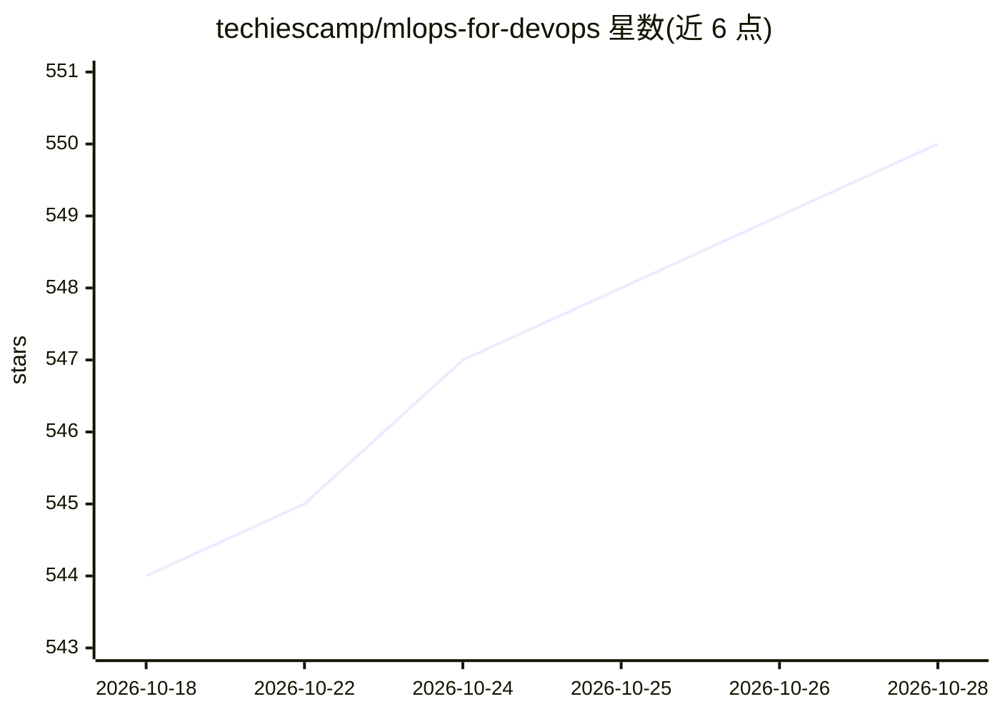

# techiescamp/mlops-for-devops

⭐ 550 · Python · NOASSERTION · 推送 2026-10-24 · [GitHub](https://github.com/techiescamp/mlops-for-devops) · [官网](https://devopscube.com/devops-to-mlops/) · 组织维护

**面向 DevOps 工程师的 MLOps 实操教程仓库**

以项目实践方式讲解机器学习运维（MLOps）的教程仓库，目标读者为 DevOps、Platform 和 SRE 工程师，无需 ML 背景，概念通过 DevOps 类比解释。内容分阶段推进：Phase 1 从本地开发与数据管道出发，构建员工流失预测模型并用 KServe 提供 API；Phase 2 覆盖数据版本控制（DVC）、Airflow、Feast、Kubeflow、MLflow、模型监控等企业级编排主题；Capstone 项目标注为 Planned。全部环境运行在 Kubernetes 和 Docker 上。代码按阶段目录组织。

## 筛选速览

| 维度 | 判定 | 备注 |
|---|---|---|
| AI 角色 | `ai-knowledge` | 知识聚合/清单类 |
| 许可风险 | `none` | NOASSERTION |
| 部署形态 | `None` |  |
| 模型依赖 | — | README 未给出锁定关系 |
| 硬件要求 | — | 无带数字的原话,不猜 |
| 安装摩擦 | `low` | 无编译、无系统依赖或容器化 |
| 成熟度 | `idea` | |

## 能力要点

- 以单一员工流失预测场景贯穿端到端流程
- 技术栈覆盖 Airflow、Kubeflow、MLflow、KServe、DVC、Feast 等
- 所有内容运行在 Kubernetes 与 Docker 环境
- 分阶段教程结构：本地开发→企业编排→Capstone（规划中）

## 适用场景

- DevOps 工程师系统学习 MLOps 概念与工具链
- 团队搭建基于 Kubernetes 的 ML 工作流参考路线
- 了解数据版本控制、实验跟踪、模型监控等 MLOps 实践

## 场景标签

`教程课程` `MLOps` · 领域:学习与行业

## 证据(README 行号)

> L3: A hands-on, project-based guide to Machine Learning Operations built specifically for DevOps, Platform, and SRE engi
> L21: We will start with the basics of building and training a classic ML model, then work our way up to production-ready
> L25: Everything in this roadmap **runs on Kubernetes and Docker**, and tools you will use in real-world MLOps platforms.

## 星数曲线

2026-10-18 544 → 2026-10-28 550（+6）

---
*卡片 v1 · prompt 1.4 · 生成 2026-10-21 · 置信度 high · 依据 README sha `7b69fcb93bb2` · [字段定义](../../DATASET.md)*
