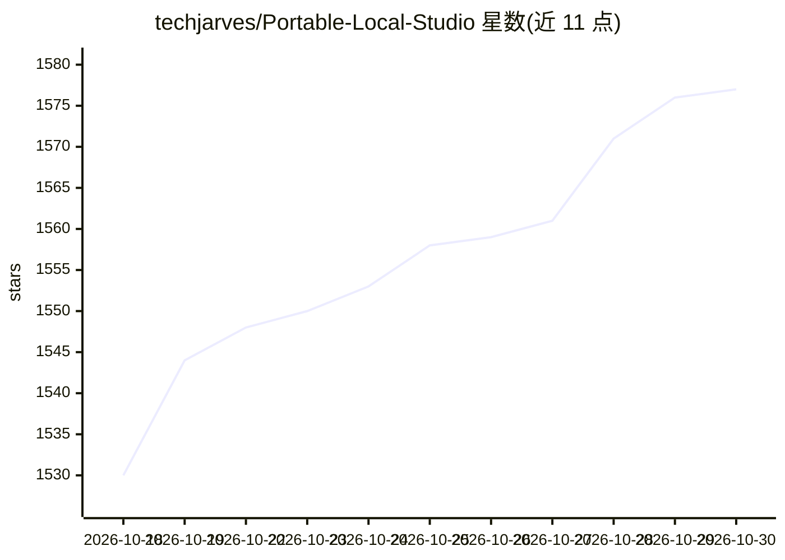

# techjarves/Portable-Local-Studio

⭐ 1,577 · JavaScript · MIT · 推送 2026-10-29 · [GitHub](https://github.com/techjarves/Portable-Local-Studio) · 个人维护

**零配置本地离线 AI 工作台：图像生成/LLM 对话/语音转文字/TTS**

面向桌面用户的自包含本地 AI 应用，整合四种能力：Stable Diffusion 图像生成（stable-diffusion.cpp 后端，支持 SD1.5/SDXL 单文件权重）、GGUF 格式 LLM 对话（llama.cpp 后端）、Whisper 语音转文字（whisper.cpp）、Kokoro TTS。运行时自带便携 Node.js，通过启动脚本（windows.bat/linux.sh/mac.sh）双击或命令行启动，浏览器访问 localhost:1420。自动检测 CUDA/ROCm/Vulkan/Metal/OpenVINO 后端；文本与图像引擎互斥以节省内存；macOS 仅支持 Apple Silicon，Linux 需 glibc 2.38+。

## 筛选速览

| 维度 | 判定 | 备注 |
|---|---|---|
| AI 角色 | `ai-native` | 本体是模型或模型工具 |
| 许可风险 | `permissive` | MIT |
| 部署形态 | `desktop` | 安装包/桌面程序 |
| 模型依赖 | local-ok | 支持本地模型 |
| 硬件要求 | — | 无带数字的原话,不猜 |
| 安装摩擦 | `high` | 编译与系统依赖俱全 |
| 成熟度 | — | 结构信号不足 |

## 能力要点

- 四合一能力：Stable Diffusion 出图、GGUF LLM 对话、Whisper 转录、Kokoro TTS，全部本地离线
- 零安装便携运行时：自带 Node.js 与后端二进制，无全局系统改动
- 自动检测 CUDA/ROCm/Vulkan/Metal/OpenVINO 加速后端
- 内置模型管理器：粘贴 Hugging Face URL 下载或拖放导入权重

## 适用场景

- 离线生成图像、与本地 LLM 对话、转录语音、合成语音，不联网不上传数据
- 在 Windows/Linux/macOS 自有 GPU/NPU 硬件上运行本地 AI 工作台
- 通过单一界面管理图像、文本、语音多类本地模型文件

## 场景标签

`图像生成` `聊天机器人` `语音识别` `语音合成` · 领域:对话与助手

## 证据(README 行号)

> L23: 1. **🎨 Image Generation (Stable Diffusion):** Generate and edit high-quality images offline using `.safetensors`, `
> L24: 2. **💬 Text Chat (LLMs):** Converse privately with open-source language models (GGUF format) powered by official, h
> L25: 3. **🎙️ Speech-to-Text (Whisper):** Transcribe voice recordings and speech to text in real-time with an integrated 
> L26: 4. **🗣️ Text-to-Speech (Kokoro TTS):** Convert text outputs into highly natural, lifelike vocal audio offline using

## 星数曲线

2026-10-18 1,530 → 2026-10-30 1,577（+47）

---
*卡片 v1 · prompt 1.4 · 生成 2026-10-21 · 置信度 high · 依据 README sha `4cbb1f36fab3` · [字段定义](../../DATASET.md)*
