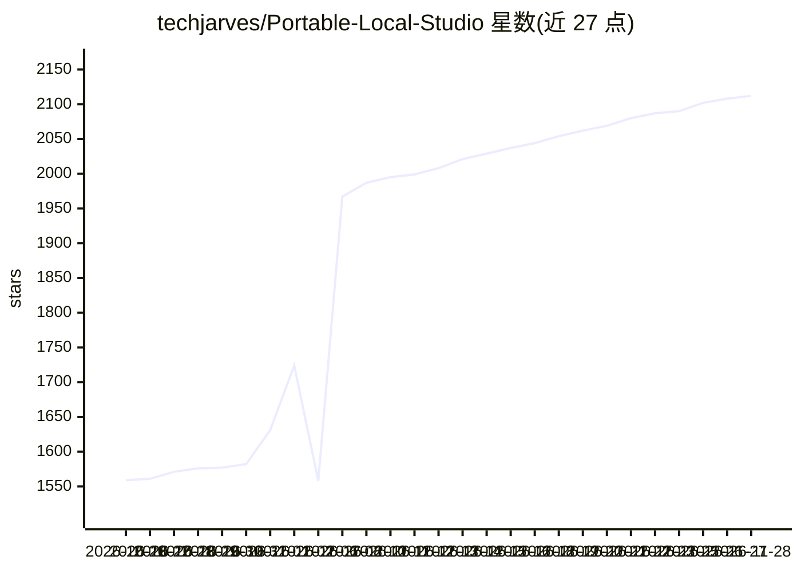

# techjarves/Portable-Local-Studio

⭐ 2,112 · JavaScript · MIT · 推送 2026-11-14 · [GitHub](https://github.com/techjarves/Portable-Local-Studio) · [官网](https://youtu.be/u89EoYOkA6U?si=AjTHc6zO8TYaIDcP) · 个人维护

**零配置离线桌面 AI 工作室：本地运行图像生成、LLM 对话、语音转写与合成**

面向 Windows/Linux/macOS 的自包含离线 AI 桌面应用，通过浏览器访问本地 Web UI（端口 1420）。整合四类能力：基于 stable-diffusion.cpp 的图像生成（.safetensors/.gguf/.ckpt 权重）、基于 llama.cpp 的 GGUF 文本对话、whisper.cpp 语音转写、Kokoro-82M ONNX 文本转语音。运行时自带便携 Node.js 与预编译 GPU 后端，自动检测硬件加载 CUDA/ROCm/Vulkan/Metal/OpenVINO。文本与图像引擎互斥运行以避免内存耗尽。无登录、无遥测、无 API key。

## 筛选速览

| 维度 | 判定 | 备注 |
|---|---|---|
| AI 角色 | `ai-native` | 本体是模型或模型工具 |
| 许可风险 | `permissive` | MIT |
| 部署形态 | `desktop` | 安装包/桌面程序 |
| 模型依赖 | local-ok | 支持本地模型 |
| 硬件要求 | — | 无带数字的原话,不猜 |
| 安装摩擦 | `high` | 编译与系统依赖俱全 |
| 成熟度 | — | 结构信号不足 |

## 能力要点

- 四合一离线工作区：Stable Diffusion 图像生成、GGUF 聊天、Whisper 转写、Kokoro 语音合成
- 自动检测硬件并加载 CUDA/ROCm/Vulkan/Metal/OpenVINO 后端
- 内置模型管理器：粘贴 Hugging Face URL 下载或拖入本地权重
- 实时监控 CPU/RAM/GPU/VRAM 利用率，输出图片与 prompt 元数据一同存档

## 适用场景

- 无网络环境下本地生成和编辑图片
- 私有对话，数据不出本机
- 本地转写语音录音为文字
- 离线将文本转成自然语音

## 场景标签

`图像生成` `聊天机器人` `语音识别` `语音合成` · 领域:对话与助手

## 证据(README 行号)

> L40: **Portable AI Studio** is a completely offline, zero-setup, self-contained AI studio for Windows, Linux, and macOS.
> L42: It unifies four major local AI capabilities into one high-performance desktop interface:
> L50: * **100% Offline & Private:** Run inferences locally. No internet, telemetry, cloud logging, or API keys required.

## 星数曲线

2026-10-26 1,559 → 2026-11-28 2,112（+553）

---
*卡片 v1 · prompt 1.4 · 生成 2026-11-23 · 置信度 high · 依据 README sha `ce2ff43283f4` · [字段定义](../../DATASET.md)*
