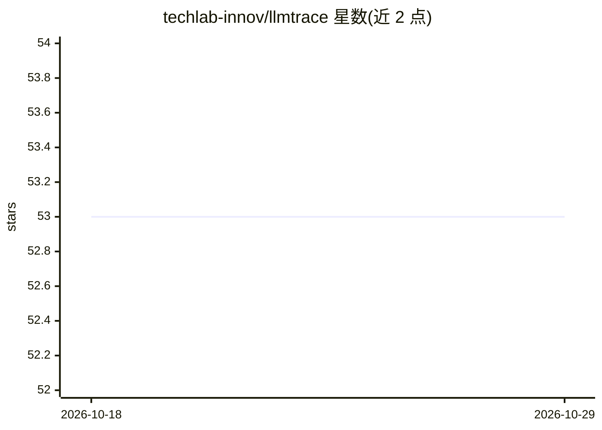

# techlab-innov/llmtrace

⭐ 53 · Python · MIT · 推送 2026-08-09 · [GitHub](https://github.com/techlab-innov/llmtrace) · [官网](http://docs.llmtrace.io/) · 组织维护

**零代码 LLM 安全与可观测代理：注入检测、PII 扫描与成本控制**

用 Rust 编写的代理网关，部署在 OpenAI 兼容客户端与上游提供商（OpenAI、Anthropic 等）之间，仅改 base URL 即可获得提示注入检测、PII 面板保护、链路追踪与成本控制，无需 SDK 改动。自托管路径为 docker compose 启动代理与仪表盘，生产栈含 ClickHouse/Postgres/Redis；另有可选的 pip 安装的 Python tracing 辅助库。自 v0.4.0 起引擎转为私有开发并以容器镜像按 Elastic License 2.0 分发，本仓库仅保留核心 crate、文档与部署配置（MIT）。

## 筛选速览

| 维度 | 判定 | 备注 |
|---|---|---|
| AI 角色 | `ai-ecosystem` | LLM/agent 周边工具 |
| 许可风险 | `permissive` | MIT |
| 部署形态 | `self-host` | docker 或自建部署 |
| 模型依赖 | — | README 未给出锁定关系 |
| 硬件要求 | — | 无带数字的原话,不猜 |
| 安装摩擦 | `low` | 无编译、无系统依赖或容器化 |
| 成熟度 | — | 结构信号不足 |

## 能力要点

- 作为 OpenAI 兼容代理提供提示注入检测、PII 保护、追踪与成本控制
- 客户端仅需改 base URL，无需 SDK 改动
- docker compose 一键自托管，含代理与仪表盘镜像
- 可选 pip 安装 llmtracing 作为 Python 追踪辅助

## 适用场景

- 为 AI agent / LLM 应用的 API 流量加安全与审计层
- 拦截提示注入与 PII 泄露并做成本管控
- 自托管替代直连 OpenAI/Anthropic 的接入点

## 场景标签

`LLM 可观测性` `网络安全` `模型网关` · 领域:Agent 开发

## 证据(README 行号)

> L7: LLMTrace is a drop-in security and observability gateway for AI agents and
> L8: LLM applications. Point your OpenAI-compatible client at the proxy and get
> L9: prompt-injection detection, PII protection, tracing, and cost control in

## 星数曲线

2026-10-18 53 → 2026-10-29 53（+0）

---
*卡片 v1 · prompt 1.4 · 生成 2026-10-24 · 置信度 mid · 依据 README sha `606513a53f7e` · [字段定义](../../DATASET.md)*
