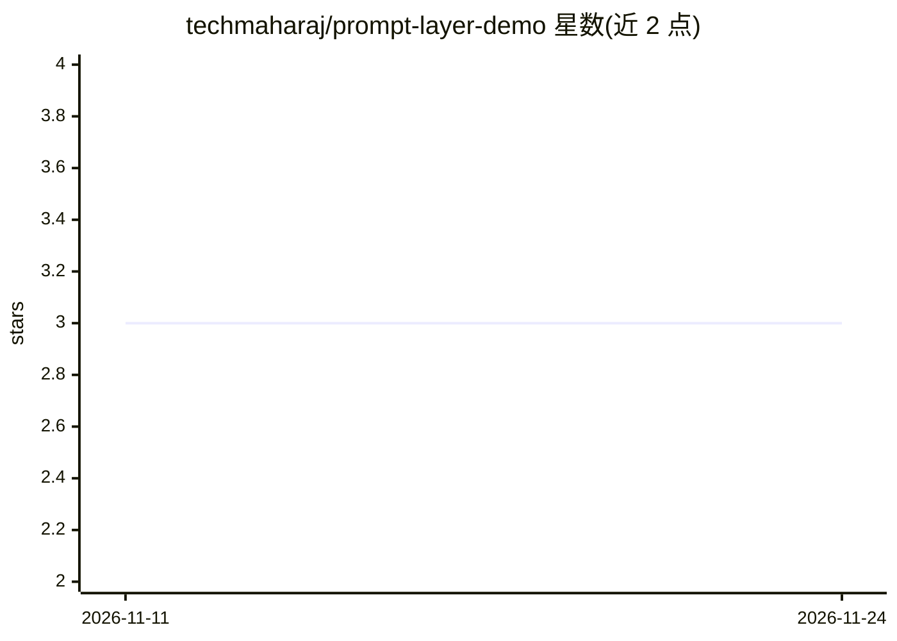

# techmaharaj/prompt-layer-demo

⭐ 3 · Python · MIT · 推送 2026-11-06 · [GitHub](https://github.com/techmaharaj/prompt-layer-demo) · 个人维护

**Kubernetes 上 AI 网关前的能力治理演示层**

为 KubeCon North America 2026 准备的演示仓库，在 AI 网关之前加一层能力（capability）治理：每个能力以 YAML 声明 owner、模型、上下文模板与预算，开发者按名调用而不选模型。通过 Kyverno ValidatingPolicy 在边界校验工具调用，ClusterPolicy 在集群层兜底拦截，OpenTelemetry 记录跨越边界的请求链路。无 config.yaml 时以 fixtures 罐头响应运行全部组件。Python 3.11+ 运行，Kyverno CLI 为组件 4 所需。

## 筛选速览

| 维度 | 判定 | 备注 |
|---|---|---|
| AI 角色 | `ai-ecosystem` | LLM/agent 周边工具 |
| 许可风险 | `permissive` | MIT |
| 部署形态 | `desktop` | 安装包/桌面程序 |
| 模型依赖 | local-ok | 支持本地模型 |
| 硬件要求 | — | 无带数字的原话,不猜 |
| 安装摩擦 | `low` | 无编译、无系统依赖或容器化 |
| 成熟度 | — | 结构信号不足 |

## 能力要点

- YAML 能力声明含 owner/模型/上下文模板/预算五要素
- Kyverno 边界校验与集群级 ClusterPolicy 双重拦截
- OpenTelemetry span 记录 capability.owner、policy.decision 等属性
- 无后端时可用 canned fixtures 运行 14 项自检

## 适用场景

- 为企业内 LLM 调用定义谁拥有哪个用途的决策
- 演示 AI agent 工具调用在边界与集群两层被拦截
- 在 Kubernetes 平台上给 AI 网关补充治理与审计层

## 场景标签

`模型网关` `LLM 可观测性` · 领域:Agent 开发

## 证据(README 行号)

> L24: Most teams already have the tooling. An AI gateway gives you virtual keys,
> L36: A **capability** is where one of those decisions lives:
> L106: That works with OpenAI, OpenRouter, LiteLLM, Ollama, llama.cpp, vLLM or anything

## 星数曲线

2026-11-11 3 → 2026-11-24 3（+0）

---
*卡片 v1 · prompt 1.4 · 生成 2026-11-21 · 置信度 high · 依据 README sha `f691429bd83e` · [字段定义](../../DATASET.md)*
