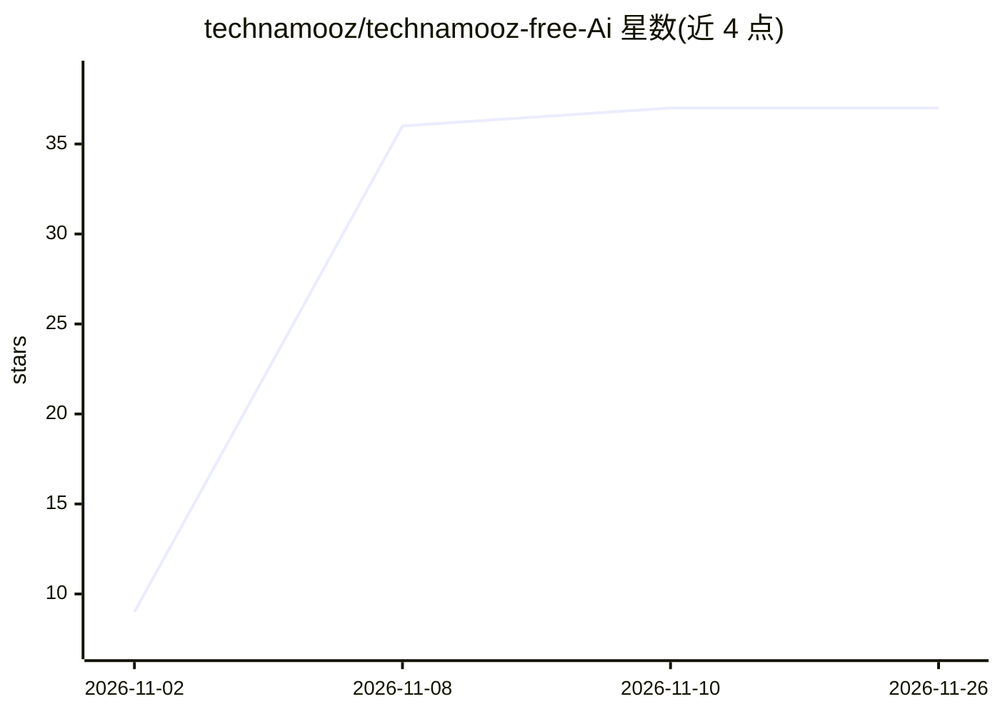

# technamooz/technamooz-free-Ai

⭐ 37 · JavaScript · MIT · 推送 2026-11-01 · [GitHub](https://github.com/technamooz/technamooz-free-Ai) · 个人维护 · 中文 README

**部署在 Cloudflare Workers 的波斯语 AI 聊天应用（网页+Telegram）**

单一 Cloudflare Worker 上运行的波斯语 RTL 聊天应用，含网页聊天、Telegram 机器人与独立管理面板三部分。接入四个 AI 服务：Cloudflare Workers AI（默认 binding）、OpenRouter、OrcaRouter、OneRouter，模型列表从各服务 API 实时获取并缓存于 KV 6 小时。提供 16 个专业人物设定、SSE 流式输出、按用户隔离的长期记忆（对话摘要+事实）。无服务器、无数据库、无 Python，依赖 KV 存储。默认管理入口为 admin/admin，需首登后修改。

## 筛选速览

| 维度 | 判定 | 备注 |
|---|---|---|
| AI 角色 | `ai-native` | 本体是模型或模型工具 |
| 许可风险 | `permissive` | MIT |
| 部署形态 | `library` | 以包/库形式分发 |
| 模型依赖 | locked-api |  |
| 硬件要求 | — | 无带数字的原话,不猜 |
| 安装摩擦 | `low` | 无编译、无系统依赖或容器化 |
| 成熟度 | — | 结构信号不足 |

## 能力要点

- 单 Worker 同时提供网页聊天、Telegram 机器人和管理面板
- 接入 4 个 AI 服务（Workers AI/OpenRouter/OrcaRouter/OneRouter）并支持 fallback
- 16 个专业人物设定，与所有模型组合可用
- 按用户隔离的长期记忆与 SSE 流式输出

## 适用场景

- 在 Cloudflare 免费套餐上部署无服务器的 AI 聊天服务
- 通过 Telegram 机器人使用同一套 AI 能力与记忆
- 为波斯语用户提供 RTL 界面的多模型聊天

## 场景标签

`聊天机器人` · 领域:对话与助手

## 证据(README 行号)

> L17: **چت وب · ربات تلگرام · پنل مدیریت · چهار سرویس‌دهندهٔ AI · ۱۶ شخصیت تخصصی**
> L71: - ⚡ **استریم واقعی** پاسخ (SSE)، نمایش استدلال مدل‌های reasoning، Markdown، کپی پاسخ و تولید دوباره
> L123: ## 🔌 چهار سرویس‌دهندهٔ هوش مصنوعی

## 星数曲线

2026-11-02 9 → 2026-11-26 37（+28）

---
*卡片 v1 · prompt 1.4 · 生成 2026-11-18 · 置信度 high · 依据 README sha `29fa4a238739` · [字段定义](../../DATASET.md)*
