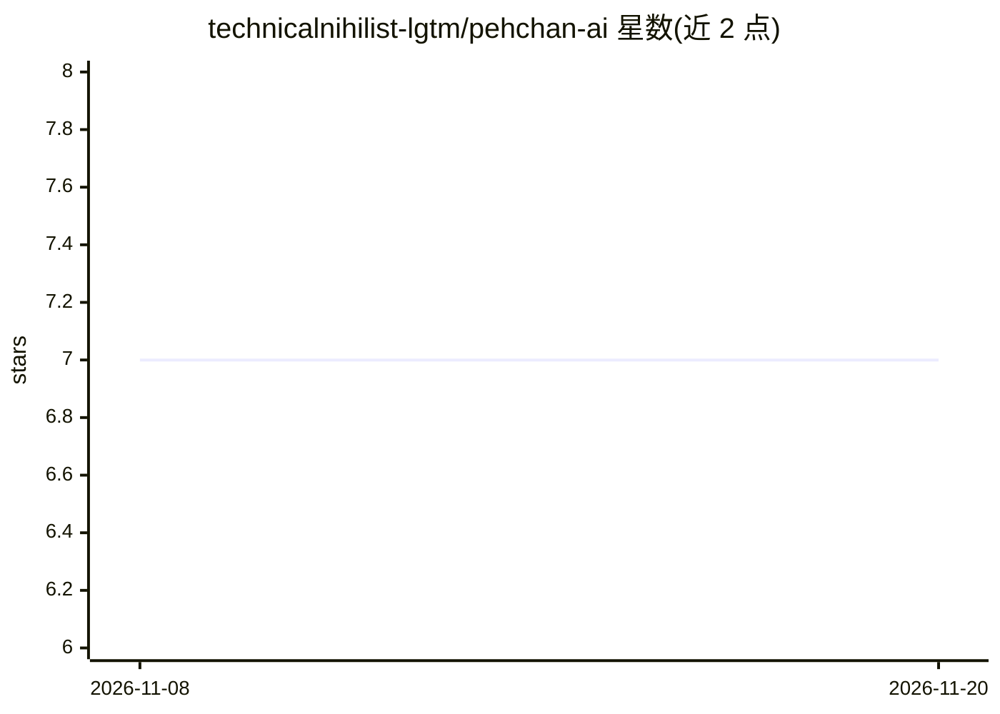

# technicalnihilist-lgtm/pehchan-ai

⭐ 7 · Java · MIT · 推送 2026-11-19 · [GitHub](https://github.com/technicalnihilist-lgtm/pehchan-ai) · [官网](https://github.com/technicalnihilist-lgtm/pehchan-ai/releases/latest) · 个人维护

**Android 离线图片物体识别应用：本地模型识别照片中的物体**

面向 Android 用户的离线图像识别应用，使用两个 TFLite 模型：SSD MobileNet V1 检测器（COCO 80 类）画出物体框并列出置信度，EfficientNet-Lite0 分类器（ImageNet 1000 类）对整图或点击裁剪区域给出细粒度识别结果与置信度措辞。应用声明无互联网权限，模型与运行时打包在约 14 MB 的 APK 内，支持 arm64-v8a/armeabi-v7a/x86/x86_64 四种架构，要求 Android 5.0+。提供 APK 下载安装，源码用 Android SDK build-tools 构建而不依赖 Gradle。

## 筛选速览

| 维度 | 判定 | 备注 |
|---|---|---|
| AI 角色 | `ai-native` | 本体是模型或模型工具 |
| 许可风险 | `permissive` | MIT |
| 部署形态 | `None` |  |
| 模型依赖 | — | README 未给出锁定关系 |
| 硬件要求 | — | 无带数字的原话,不猜 |
| 安装摩擦 | `low` | 无编译、无系统依赖或容器化 |
| 成熟度 | — | 结构信号不足 |

## 能力要点

- 两个 TFLite 模型：SSD-MobileNet 检测器（COCO 80 类）+ EfficientNet-Lite0 分类器（ImageNet 1000 类）
- 100% 离线运行，APK 声明无互联网、存储、相机、位置权限
- 点击任一物体框对裁剪区域运行细粒度分类
- 提供 Google Lens 跳转与 Wikipedia 词条入口处理模型不认识的对象

## 适用场景

- 在无网络环境下识别照片中的物体及其类别
- 对照片中的特定物体做细粒度辨认（如犬种）
- 查看照片尺寸、光照与主色调信息

## 场景标签

`目标检测` · 领域:感知与多模态

## 证据(README 行号)

> L34: * **Finds every object** — an on-device detector draws a box around each thing it sees and
> L53: |**100% offline**|The app declares **no internet permission at all** — it physically cannot upload your photos.|
> L62:       ├─► 300×300  SSD-MobileNet detector ──► up to 10 boxes + labels  ──► drawn on the photo

## 星数曲线

2026-11-08 7 → 2026-11-20 7（+0）

---
*卡片 v1 · prompt 1.4 · 生成 2026-11-20 · 置信度 high · 依据 README sha `6e607044fa8b` · [字段定义](../../DATASET.md)*
