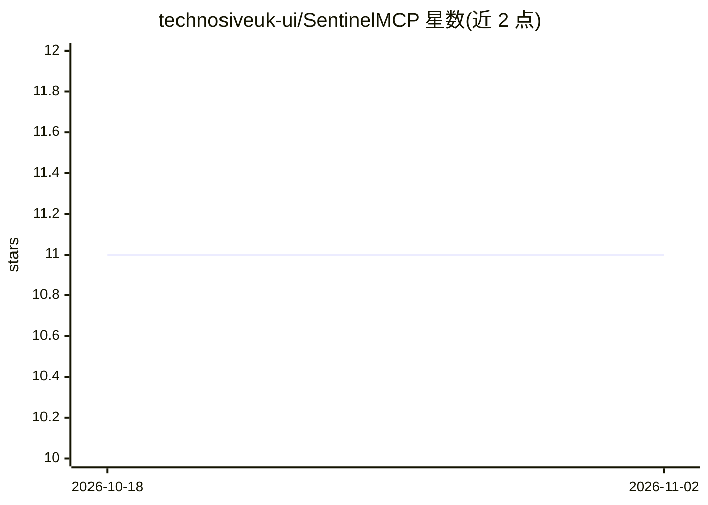

# technosiveuk-ui/SentinelMCP

⭐ 11 · Go · Apache-2.0 · 推送 2026-06-13 · [GitHub](https://github.com/technosiveuk-ui/SentinelMCP) · [官网](https://technosive.co.uk/sentinelmcp) · 组织维护

**面向 MCP 的 AI Agent 安全网关：拦截工具调用做检查/脱敏/审批**

MCP（Model Context Protocol）安全执行引擎，部署在 AI Agent 与其调用的 MCP 工具之间：对工具调用的参数与响应做检查、按 YAML 策略的风险等级（低/中/高）路由到允许/脱敏/中断审批/阻断，提供 6 种内置正则的 PII 与密钥脱敏、Webhook 人在回路审批、BoltDB 检查点持久化中断恢复、JSON 审计日志与 OpenTelemetry 集成。两种部署模式：任意语言可用的 HTTP/SSE 代理 sidecar（Docker 运行），以及 Go 进程内 SDK（v0.2.0+）。面向需要管控 Agent 工具调用安全的企业与开发者；当前为 Alpha 版（v0.1），API 与配置格式可能变更。

## 筛选速览

| 维度 | 判定 | 备注 |
|---|---|---|
| AI 角色 | `ai-ecosystem` | LLM/agent 周边工具 |
| 许可风险 | `permissive` | Apache-2.0 |
| 部署形态 | `self-host` | docker 或自建部署 |
| 模型依赖 | — | README 未给出锁定关系 |
| 硬件要求 | — | 无带数字的原话,不猜 |
| 安装摩擦 | `low` | 无编译、无系统依赖或容器化 |
| 成熟度 | `idea` | |

## 能力要点

- 代理模式（任意语言/框架零代码改动）与 Go Inline SDK 双部署模式
- YAML 策略引擎：风险等级映射 allow/redact/block/interrupt，支持热重载
- DLP：6 种内置 PII/密钥正则模式 + 自定义正则，作用于请求与响应
- BoltDB 检查点支持的 interrupt/resume 人在回路审批

## 适用场景

- 拦截 AI Agent 的工具调用，阻止高风险操作或先经人工审批
- 在工具参数与响应中脱敏密钥、信用卡号等敏感数据
- 为 Agent 系统输出结构化审计日志并接入 SIEM

## 场景标签

`网络安全` · 领域:学习与行业

## 证据(README 行号)

> L23: SentinelMCP is a security enforcement engine for the **Model Context Protocol (MCP)** that secures AI agent tool ca
> L33: A standalone sidecar binary that intercepts HTTP/SSE MCP traffic. Works with **any language** (Python, TypeScript, 

## 星数曲线

2026-10-18 11 → 2026-11-02 11（+0）

---
*卡片 v1 · prompt 1.4 · 生成 2026-11-01 · 置信度 high · 依据 README sha `09f32e20f514` · [字段定义](../../DATASET.md)*
