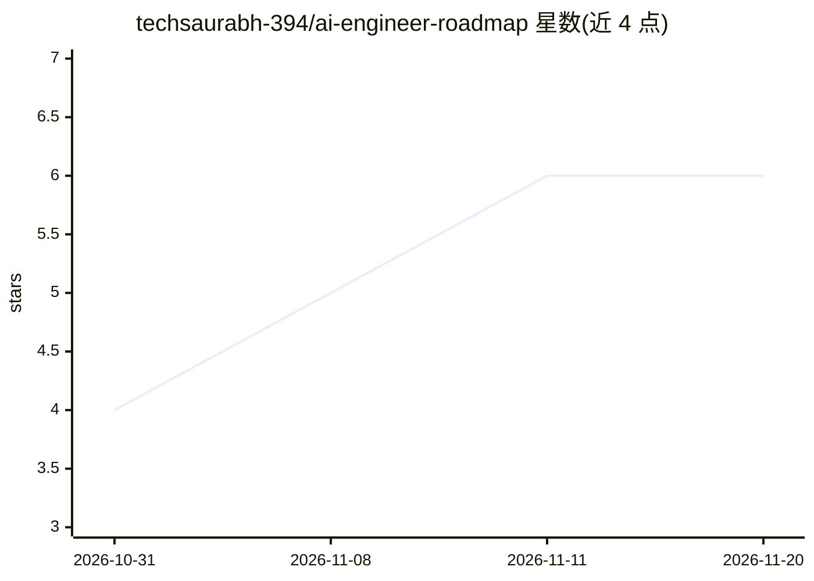

# techsaurabh-394/ai-engineer-roadmap

⭐ 6 · Python · MIT · 推送 2026-11-15 · [GitHub](https://github.com/techsaurabh-394/ai-engineer-roadmap) · [官网](https://techsaurabh-394.github.io/ai-engineer-roadmap/) · 个人维护

**面向 AI 工程学习者的 132 主题路线图教程库**

以 10 个阶段组织 132 个 AI 工程主题（RAG、LLM 原理、Agent、MCP、框架、生产部署、微调、多模态），每主题含示意图、Python 代码、3 道面试题与论文/文档链接。示例脚本仅用标准库、离线可运行、无需 API key；设 ANTHROPIC_API_KEY 时可用 Claude 生成答案。另含 43 题面试准备、学习路径、练习题与交互式测验、动画演示站点。面向初学者、转型开发者与求职者。

## 筛选速览

| 维度 | 判定 | 备注 |
|---|---|---|
| AI 角色 | `ai-knowledge` | 知识聚合/清单类 |
| 许可风险 | `permissive` | MIT |
| 部署形态 | `self-host` | docker 或自建部署 |
| 模型依赖 | — | README 未给出锁定关系 |
| 硬件要求 | — | 无带数字的原话,不猜 |
| 安装摩擦 | `low` | 无编译、无系统依赖或容器化 |
| 成熟度 | — | 结构信号不足 |

## 能力要点

- 132 主题分 10 阶段，附勾选进度清单
- 示例脚本仅用标准库，离线运行无需 API key
- 每主题含 3 道面试题，另有 43 题面试准备文件夹
- 提供动画演示、交互式查看器与闪卡测验

## 适用场景

- 按阶段系统学习 RAG、Agent、MCP 等 AI 工程主题
- 求职面试前复习概念题与系统设计题
- 按学习路径计划每天的学习进度并勾选打卡

## 场景标签

`教程课程` · 领域:学习与行业

## 证据(README 行号)

> L5:  Learn RAG, LLMs, AI agents, frameworks, MCP and production AI step by step, with runnable code, diagrams and interv
> L15: **132 topics in 10 phases (Phase 0 to 9)**, each explained in plain English with an everyday analogy, a diagram, Py
> L41: - **Beginners** who keep hearing "RAG", "agents" and "MCP" and want to finally understand them

## 星数曲线

2026-10-31 4 → 2026-11-20 6（+2）

---
*卡片 v1 · prompt 1.4 · 生成 2026-11-20 · 置信度 mid · 依据 README sha `18626140b301` · [字段定义](../../DATASET.md)*
