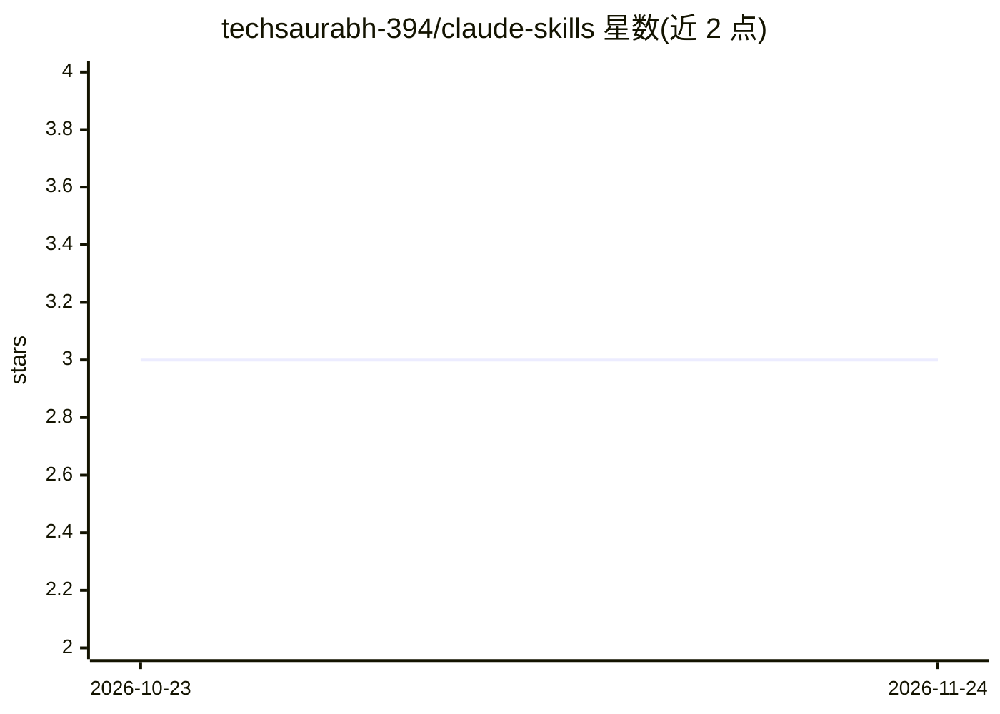

# techsaurabh-394/claude-skills

⭐ 3 · MIT · 推送 2026-10-22 · [GitHub](https://github.com/techsaurabh-394/claude-skills) · 个人维护

**面向 SEO、技术写作与 MCP 开发的 Claude Skills 集合**

作者个人使用的 Claude Skills 集合，每个技能是一个含 SKILL.md（YAML frontmatter + 指令）的文件夹，安装方式为将文件夹复制到 Claude 技能目录或在设置中上传 zip。现有三个技能：页面技术 SEO 与 GEO（AI 答案引擎可见性）审计、面向开发者的技术博客写作、TypeScript MCP 服务器脚手架生成。README 给出技能约定与贡献规范，路线图列出后续技能计划。

## 筛选速览

| 维度 | 判定 | 备注 |
|---|---|---|
| AI 角色 | `ai-knowledge` | 知识聚合/清单类 |
| 许可风险 | `permissive` | MIT |
| 部署形态 | `None` |  |
| 模型依赖 | — | README 未给出锁定关系 |
| 硬件要求 | — | 无带数字的原话,不猜 |
| 安装摩擦 | `low` | 无编译、无系统依赖或容器化 |
| 成熟度 | — | 结构信号不足 |

## 能力要点

- 三个技能：seo-geo-audit、technical-blog-writer、mcp-server-builder
- SKILL.md 格式（YAML frontmatter + 指令），文件夹即装即用
- 支持复制到本地 skills 目录或通过 Claude 设置上传 zip
- MCP 技能提供类型化工具与测试清单的脚手架

## 适用场景

- 审计页面的技术 SEO 与 AI 答案引擎可见性并获取修复清单
- 撰写可被引用的开发者向技术博客
- 快速搭建带类型化工具的 TypeScript MCP 服务器

## 场景标签

`提示工程` `代码生成` `AI 写作` · 领域:Agent 开发

## 证据(README 行号)

> L5: Reusable Claude Skills I use for SEO, technical writing and AI-agent engineering. Each skill is a folder with a `SKI
> L9: |`seo-geo-audit`|Audit a page for technical SEO and GEO (visibility in AI answer engines) and get a prioritised fix 

## 星数曲线

2026-10-23 3 → 2026-11-24 3（+0）

---
*卡片 v1 · prompt 1.4 · 生成 2026-11-21 · 置信度 high · 依据 README sha `e4659afc38ae` · [字段定义](../../DATASET.md)*
