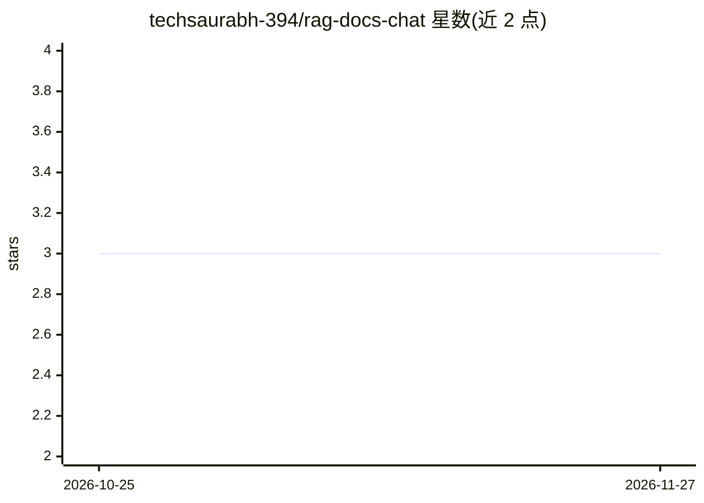

# techsaurabh-394/rag-docs-chat

⭐ 3 · Python · MIT · 推送 2026-11-10 · [GitHub](https://github.com/techsaurabh-394/rag-docs-chat) · 个人维护

**上传 PDF 提问并返回带出处引用答案的 RAG 应用**

一个约 500 行 Python 的文档问答应用：上传 PDF/TXT/MD 后分块索引，检索采用 BM25 加向量混合（RRF 融合），答案标注文档、页码与片段出处，并对每句做词面 faithfulness 检查标记无依据句子。设置 ANTHROPIC_API_KEY 时由 Claude 生成答案，无 key 时以抽取模式返回最佳片段，整站可无 key 无模型下载运行。通过 FastAPI 提供 API，自带 vanilla JS 单页 UI、31 个测试与检索评测脚本（hit@1/hit@3/MRR）。

## 筛选速览

| 维度 | 判定 | 备注 |
|---|---|---|
| AI 角色 | `ai-native` | 本体是模型或模型工具 |
| 许可风险 | `permissive` | MIT |
| 部署形态 | `self-host` | docker 或自建部署 |
| 模型依赖 | — | README 未给出锁定关系 |
| 硬件要求 | — | 无带数字的原话,不猜 |
| 安装摩擦 | `low` | 无编译、无系统依赖或容器化 |
| 成熟度 | — | 结构信号不足 |

## 能力要点

- 混合检索：BM25 与向量检索经 RRF 融合，可切换三种模式
- 答案附文档、页码、片段级引用及逐句 faithfulness 分数
- 无 API key 时以抽取模式运行，无需模型下载
- 附带检索评测脚本与内置基准（18 问，3 文档）

## 适用场景

- 对自己的 PDF 文档集提问并核对引用出处
- 作为 RAG 入门学习材料阅读源码并跑通课程
- 对比 local/bm25/hybrid 三种检索的召回指标
- 在 Render 上以 Docker 镜像部署一个文档问答服务

## 场景标签

`文档问答` `RAG` `模型评测` · 领域:评测与运维

## 证据(README 行号)

> L14: Upload PDFs or text files, ask questions, and get answers that **cite the exact source passage** (document, page an
> L55: - **With `ANTHROPIC_API_KEY`:** Claude writes the answer from the retrieved passages and cites sources. If the pass

## 星数曲线

2026-10-25 3 → 2026-11-27 3（+0）

---
*卡片 v1 · prompt 1.4 · 生成 2026-11-21 · 置信度 high · 依据 README sha `3933b10728e8` · [字段定义](../../DATASET.md)*
