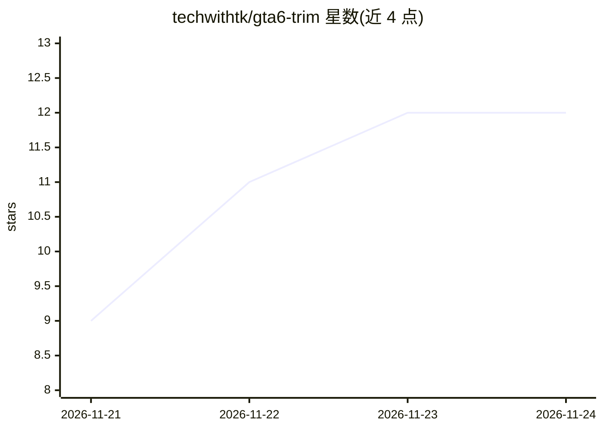

# techwithtk/gta6-trim

⭐ 12 · TypeScript · 推送 2026-11-19 · [GitHub](https://github.com/techwithtk/gta6-trim) · [官网](https://gta6trim.com) · 个人维护

**为 GTA 6 主播/剪辑号自动从直播切出竖屏 Shorts**

面向 GTA 6 内容创作者的 SaaS：监控 Twitch 上的 GTA 6 直播，基于聊天活跃度峰值（hype score）标记高光时刻，自动裁切为 9:16 竖屏、跟随画面动作、生成字幕与各平台标题/话题标签，导出 1080p 无水印短视频，可下载或发布到 TikTok/YouTube Shorts/Instagram Reels/Facebook。分三档付费订阅（$49-$199/月），Studio 档支持多账号自动发布与排期。README 同时公开 Next.js 源码与本地运行步骤，但注明源码仅供透明与学习，禁止重新部署为竞争服务。

## 筛选速览

| 维度 | 判定 | 备注 |
|---|---|---|
| AI 角色 | `ai-native` | 本体是模型或模型工具 |
| 许可风险 | `none` | — |
| 部署形态 | `library` | 以包/库形式分发 |
| 模型依赖 | — | README 未给出锁定关系 |
| 硬件要求 | — | 无带数字的原话,不猜 |
| 安装摩擦 | `low` | 无编译、无系统依赖或容器化 |
| 成熟度 | — | 结构信号不足 |

## 能力要点

- 按聊天活跃度峰值（hype score）自动定位直播高光时刻
- 自动 9:16 裁切（跟随画面动作）+ AI 字幕（8 种样式）
- 支持最多同时剪辑 10 路直播与最长 6 小时 YouTube VOD 导入
- Studio 档自动发布至 TikTok/YouTube/Instagram/Facebook（每平台 3 账号）

## 适用场景

- 把 GTA 6 直播高光自动剪成竖屏短视频发到各平台
- 同时追踪多路直播、抢先发布热门片段
- 剪辑代理团队管理多账号与排期发布

## 场景标签

`图像视频处理` · 领域:感知与多模态

## 证据(README 行号)

> L7: GTA6 Trim watches live GTA 6 streams and long YouTube videos, catches the second chat loses its mind, cuts it to 9:1
> L29: |**2. It finds the moments**|Chat activity spikes (laughs, "CLIP IT", emote floods) mark the best seconds. Each mom
> L59: - 💬 **AI captions**: 8 caption styles plus your brand colours

## 星数曲线

2026-11-21 9 → 2026-11-24 12（+3）

---
*卡片 v1 · prompt 1.4 · 生成 2026-11-21 · 置信度 high · 依据 README sha `6a0d1c0cadc7` · [字段定义](../../DATASET.md)*
