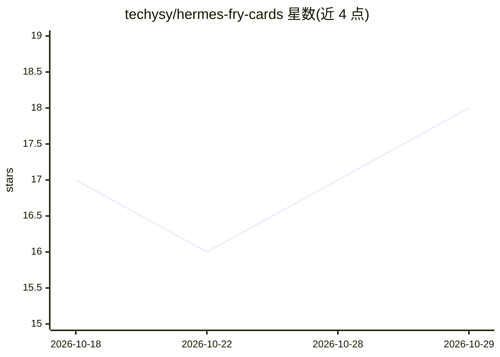

# techysy/hermes-fry-cards

⭐ 18 · Python · MIT · 推送 2026-10-27 · [GitHub](https://github.com/techysy/hermes-fry-cards) · 个人维护 · 中文 README

**Hermes Agent 网关的飞书流式卡片输出插件**

面向 Hermes Agent Gateway 的飞书/Lark 卡片插件：通过 AST hook 注入机制（不改 Hermes 核心）将 Agent 输出转为 CardKit v2.0 流式互动卡片，提供打字机逐字渲染、思考链与工具调用交错展示、统一折叠面板；内置 Markdown 防爆引擎（18KB 预算、逼近 200 元素上限自动拆卡）、图片转存为 img_key、群聊敏感凭据拦截。附带 Studio 本地 Web 配置台与 systemd 保活单元。提供一键脚本、PyPI、源码三种安装方式，需在 Hermes venv 中注入 hook 并重启网关。

## 筛选速览

| 维度 | 判定 | 备注 |
|---|---|---|
| AI 角色 | `ai-ecosystem` | LLM/agent 周边工具 |
| 许可风险 | `permissive` | MIT |
| 部署形态 | `library` | 以包/库形式分发 |
| 模型依赖 | — | README 未给出锁定关系 |
| 硬件要求 | — | 无带数字的原话,不猜 |
| 安装摩擦 | `low` | 无编译、无系统依赖或容器化 |
| 成熟度 | — | 结构信号不足 |

## 能力要点

- CardKit v2.0 流式打字机输出与思考/工具交错渲染
- Markdown 防爆引擎：18KB 预算、超限表格重排、逼近 200 元素上限自动拆卡续流
- 群聊安全边界拦截 API Token、内网 IP 等敏感凭据输出
- Studio 本地 Web 配置台（含 Builder 实时渲染预览、配置备份与原子落盘）

## 适用场景

- 把 Hermes Agent 的回复以飞书流式卡片形式实时展示
- 在群聊中防止 Agent 泄露 API Key 等敏感信息
- 通过可视化界面配置卡片布局与模型别名

## 场景标签

 · 领域:IM 集成/Agent 输出渲染

## 证据(README 行号)

> L14: > **这是什么**：一个专为 Hermes Agent Gateway 定制的**飞书流式卡片插件**。通过底层 AST hook 注入机制，在不侵入破坏 Hermes 核心的前提下，将 Agent 的每一次输出升级为飞书 Ca
> L19:  hermes-fry-cards 架构：Hermes Gateway 事件经 AST hook 注入层进入 StreamCardController，streaming/ 运行时节流编排，cardkit/ 构建卡片 JSON，经

## 星数曲线

2026-10-18 17 → 2026-10-29 18（+1）

---
*卡片 v1 · prompt 1.4 · 生成 2026-10-29 · 置信度 high · 依据 README sha `092ec745f2e1` · [字段定义](../../DATASET.md)*
