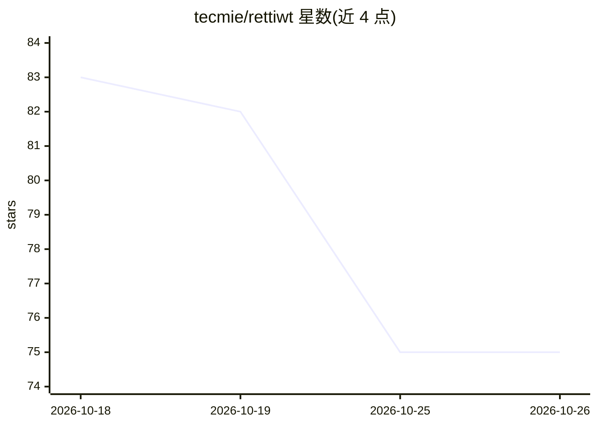

# tecmie/rettiwt

⭐ 75 · TypeScript · MIT · 推送 2026-08-28 · [GitHub](https://github.com/tecmie/rettiwt) · [官网](https://www.tecmie.xyz/research#rettiwt) · 个人维护

**AI 驱动的 Twitter 社交媒体模拟沙盒：模拟可信人类代理互动**

XIMS（X-Interactive Media Simulation）是一个基于 Next.js 的 Twitter 模拟环境：由具备人设、记忆与情感的 AI persona 生成推文、回复、转推与点赞，用于测试社交互动、PR 策略与多代理涌现行为。生成式代理遵循观察-规划-反思三步机制，基于 OpenAI GPT-3.5/GPT-4 的 Function Calling 触发互动，采用事件驱动队列架构与共享全局状态。存储使用 LanceDB、Prisma 与 PostgreSQL，附带一个尼日利亚政治议题的案例研究。通过 git clone 与 npm/yarn 安装，可部署到 AWS、Railway 或 Vercel（Vercel 上长时间队列可能有 issues）。

## 筛选速览

| 维度 | 判定 | 备注 |
|---|---|---|
| AI 角色 | `ai-native` | 本体是模型或模型工具 |
| 许可风险 | `permissive` | MIT |
| 部署形态 | `library` | 以包/库形式分发 |
| 模型依赖 | — | README 未给出锁定关系 |
| 硬件要求 | — | 无带数字的原话,不猜 |
| 安装摩擦 | `low` | 无编译、无系统依赖或容器化 |
| 成熟度 | — | 结构信号不足 |

## 能力要点

- AI persona 具备 traits、Active_memory、Passive_memory 与 sentiment
- 生成式代理的观察/规划/反思三步机制
- 事件驱动队列架构处理点赞/回复/转推任务
- 基于 OpenAI GPT-3.5/GPT-4 Function Calling 触发互动

## 适用场景

- 测试公关策略在趋势与话题标签下的传播效果
- 观察多 AI 代理互动的涌现行为
- 为政策议题构建合成的实时焦点小组模拟

## 场景标签

`多智能体` · 领域:Agent 开发

## 证据(README 行号)

> L18: `XIMS` runs a simulated environment where AI personas (authors) generate tweets, react to existing tweets, and even
> L80: This interactive simulation is built on top the OpenAI models `GPT-3.5` and `GPT-4`. Currently relying on the `Func

## 星数曲线

2026-10-18 83 → 2026-10-26 75（-8）

---
*卡片 v1 · prompt 1.4 · 生成 2026-10-24 · 置信度 high · 依据 README sha `847682633540` · [字段定义](../../DATASET.md)*
