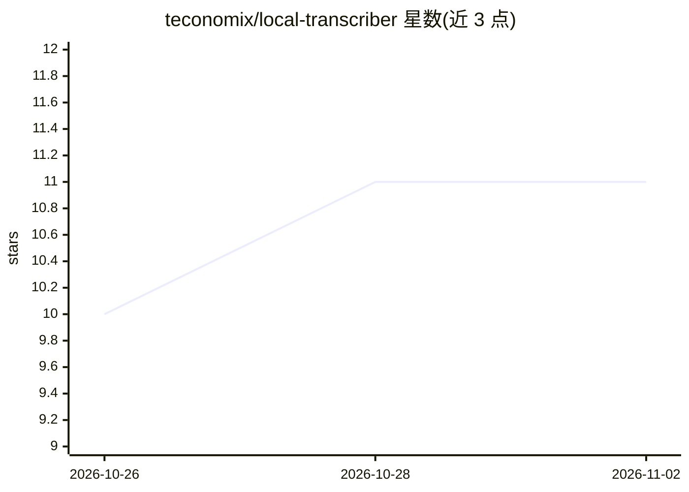

# teconomix/local-transcriber

⭐ 11 · Swift · MIT · 推送 2026-10-31 · [GitHub](https://github.com/teconomix/local-transcriber) · [官网](https://transcriber.teconomix.net/en/?k=gh-home) · 个人维护

**macOS 菜单栏本地转录工具：会议录音转写与说话人识别**

面向 Mac 用户的菜单栏应用：本地录制会议（麦克风与系统音频分轨）、用 Whisper large-v3-turbo（MLX，Apple Silicon GPU）转录、pyannote 结合学习型声音库识别说话人，支持按键全局听写。可检测 Teams/Zoom/Meet 等通话并自动启停录制，日历事件命名文件。可用本地模型（Ollama/LM Studio）或云端模型生成纪要摘要（默认仅在点击时执行，姓名替换为占位符）。要求 Apple Silicon（M1+）与 macOS 14+，16GB 内存推荐；提供 curl 安装脚本与 Homebrew cask，另含命令行与 MCP server。

## 筛选速览

| 维度 | 判定 | 备注 |
|---|---|---|
| AI 角色 | `ai-native` | 本体是模型或模型工具 |
| 许可风险 | `permissive` | MIT |
| 部署形态 | `None` |  |
| 模型依赖 | local-ok | 支持本地模型 |
| 硬件要求 | — | 无带数字的原话,不猜 |
| 安装摩擦 | `medium` | 含编译或系统依赖之一 |
| 成熟度 | — | 结构信号不足 |

## 能力要点

- Whisper large-v3-turbo（MLX）本地转录，1 小时音频含说话人识别约 3-4 分钟
- pyannote 声纹库说话人识别：命名一次后自动识别
- 按住按键在任意应用内听写
- 提供命令行接口与 MCP server 供 AI agent 调用

## 适用场景

- 在 Mac 上本地录制并转写会议，数据不出机器
- 为播客或访谈生成带说话人标签的文字稿
- 任意应用内按键听写代替键盘输入
- 用本地模型生成会议纪要与行动项

## 场景标签

`语音识别` · 领域:感知与多模态

## 证据(README 行号)

> L7: Local Transcriber (“Transcriber” for short in the menu bar) is a small menu bar tool for macOS: it records
> L22: - **Transcribe** – Whisper large-v3-turbo on the Apple Silicon GPU (MLX): one hour of audio including speaker recog
> L23: - **Recognize speakers** – pyannote with a learning voice database; name someone once, and they are recognized next

## 星数曲线

2026-10-26 10 → 2026-11-02 11（+1）

---
*卡片 v1 · prompt 1.4 · 生成 2026-11-01 · 置信度 high · 依据 README sha `88c94dea14e1` · [字段定义](../../DATASET.md)*
