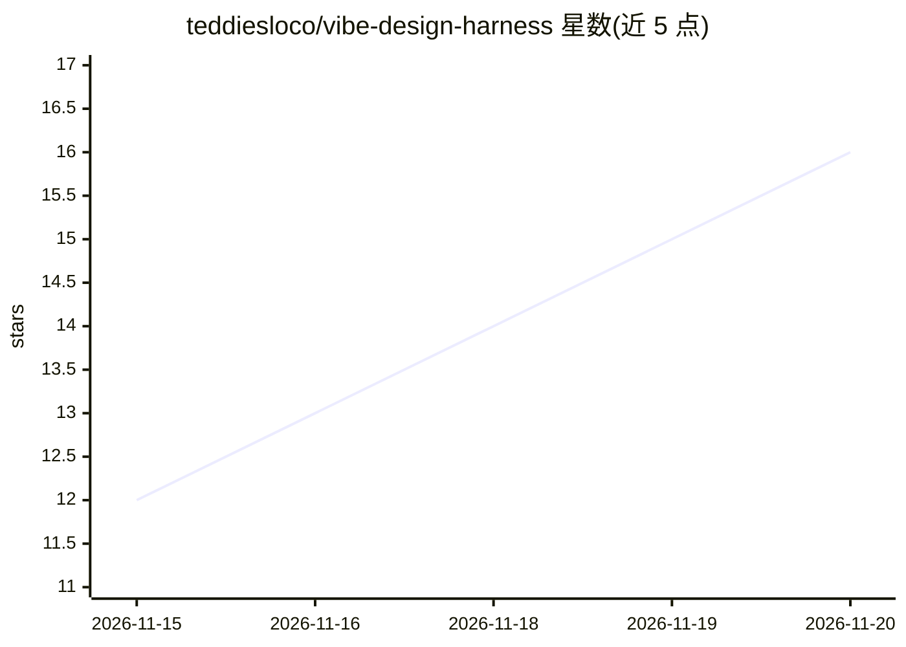

# teddiesloco/vibe-design-harness

⭐ 16 · JavaScript · 推送 2026-11-09 · [GitHub](https://github.com/teddiesloco/vibe-design-harness) · [官网](https://www.npmjs.com/package/vibe-design-harness) · 组织维护

**面向 AI Agent 的 UI/UX 设计系统引擎与反模板化检查工具**

面向在 Claude Code、Cursor、Codex、Hermes 等 Agent 环境中工作的开发者的 UI/UX 工程工具集：以 CLI（npx vibe-design-harness）与 MCP 服务器（20 个工具）形式提供。功能包括 Web 仪表盘与移动应用原型脚手架（10 种 Web Faces、9 种 Mobile Faces、97 份规格）、60fps 滚动编排引擎、从既有代码库反向提取 DESIGN.md 并编译 W3C DTCG 三层 token、40+ 规则的 anti-slop UI 检查器（lintUI/fixUI），以及 Playwright 多视口 DOM 探针。MIT 许可，由 AgentSea (AGS) 发布。

## 筛选速览

| 维度 | 判定 | 备注 |
|---|---|---|
| AI 角色 | `ai-ecosystem` | LLM/agent 周边工具 |
| 许可风险 | `none` | — |
| 部署形态 | `library` | 以包/库形式分发 |
| 模型依赖 | locked-api |  |
| 硬件要求 | — | 无带数字的原话,不猜 |
| 安装摩擦 | `low` | 无编译、无系统依赖或容器化 |
| 成熟度 | — | 结构信号不足 |

## 能力要点

- MCP 服务器暴露 20 个 UI/UX 工具，供 Claude Code/Cursor/Codex/Hermes 调用
- 40+ 规则的 sub-millisecond UI 检查器 lintUI()/fixUI() 与自动修复
- 从既有代码库反向提取 DESIGN.md 并编译 W3C DTCG 三层 token 为 CSS 变量
- 生成 Web 仪表盘/移动应用原型脚手架与 Tailwind v4 tokens.css

## 适用场景

- 让编码 Agent 在生成页面时遵循统一设计系统规格
- 对 AI 生成的 UI 运行 anti-slop 检查并自动修复
- 从现有代码库反推设计规范与 token 体系
- 生成带 60fps 滚动编排的落地页与故事页

## 场景标签

`代码生成` · 领域:编码与开发

## 证据(README 行号)

> L44: ## 🔌 Model Context Protocol (MCP Server — 20 UI/UX Tools)
> L46: Add **VibeDesign-Harness MCP** to Claude Code, Cursor, Codex, or Hermes Agent:
> L56: 1. `lint_ui_aesthetic` — Runs the 40+ gate deterministic UI/UX, Dashboard & 2-Layer Material anti-slop linter + aut

## 星数曲线

2026-11-15 12 → 2026-11-20 16（+4）

---
*卡片 v1 · prompt 1.4 · 生成 2026-11-18 · 置信度 high · 依据 README sha `cff606ab58b6` · [字段定义](../../DATASET.md)*
