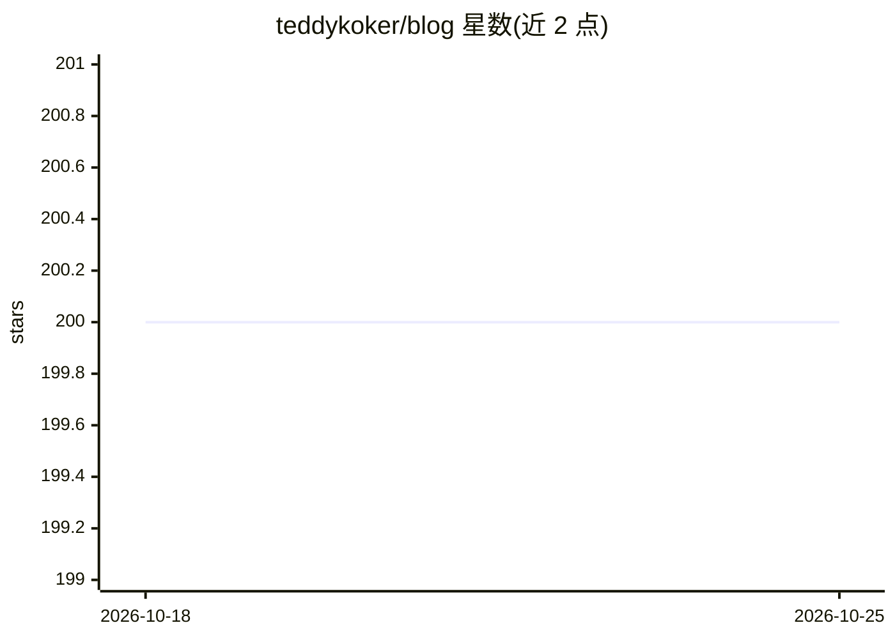

# teddykoker/blog

⭐ 200 · Jupyter Notebook · MIT · 推送 2026-05-23 · [GitHub](https://github.com/teddykoker/blog) · [官网](https://teddykoker.com) · 个人维护

**个人博客站点源码，含机器学习文章的 Notebook**

一个个人博客网站的源码仓库，README 仅说明代码对应其个人网站，并指出博文配套的 Notebook 存放于 _notebooks 目录；仓库主题标签含 machine-learning，表明内容涉及机器学习文章。仓库不提供可安装运行的产品形态说明、无依赖或部署文档描述，信息量有限，本条目仅基于可见的三行 README 编目。

## 筛选速览

| 维度 | 判定 | 备注 |
|---|---|---|
| AI 角色 | `ai-knowledge` | 知识聚合/清单类 |
| 许可风险 | `permissive` | MIT |
| 部署形态 | `None` |  |
| 模型依赖 | — | README 未给出锁定关系 |
| 硬件要求 | — | 无带数字的原话,不猜 |
| 安装摩擦 | `low` | 无编译、无系统依赖或容器化 |
| 成熟度 | — | 结构信号不足 |

## 能力要点

- 个人博客网站的源码仓库
- 博文配套 Notebook 存放于 _notebooks 目录
- 主题标签包含 machine-learning

## 适用场景

- 查阅作者的机器学习博文与配套 Notebook
- 参考博客源码结构

## 场景标签

 · 领域:个人博客/机器学习内容

## 证据(README 行号)

> L3: Source code for my website.
> L5: Notebooks for posts are available in the `_notebooks` directory.

## 星数曲线

2026-10-18 200 → 2026-10-25 200（+0）

---
*卡片 v1 · prompt 1.4 · 生成 2026-10-22 · 置信度 low · 依据 README sha `d0ecde3fd207` · [字段定义](../../DATASET.md)*
