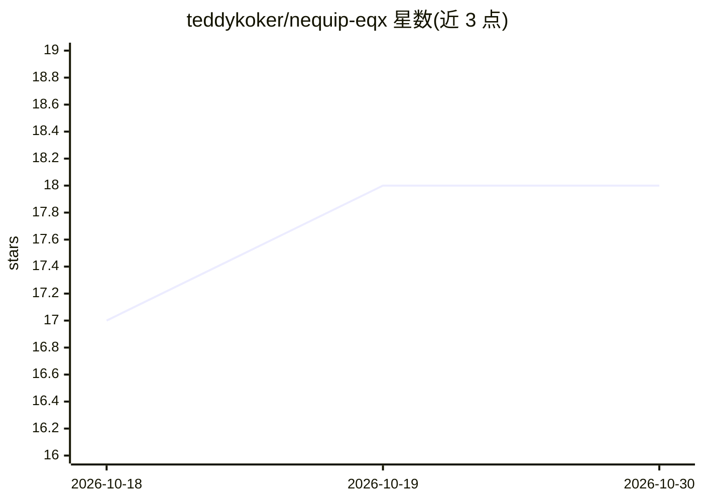

# teddykoker/nequip-eqx

⭐ 18 · Python · MIT · 推送 2026-02-24 · [GitHub](https://github.com/teddykoker/nequip-eqx) · [官网](https://pypi.org/project/nequip-eqx/) · 个人维护

**给计算化学研究者的 NequIP 力场 JAX 实现**

NequIP 神经网络原子间势（E(3)-等变图神经网络）的 JAX/Equinox 实现，目标是以少于 1000 行代码提供可训练与推理的力场模型。提供 pip 安装、yml 配置驱动的训练命令、测试命令与 ASE calculator 接口以执行分子动力学计算，附带 3BPA 数据集的示例配置与预训练权重。README 中给出与 PyTorch 版 nequip、mace 在 3BPA 上的能量/力 RMSE 对比数字，并说明强制 float32 matmul 以兼容不支持 tf32 的旧 GPU。

## 筛选速览

| 维度 | 判定 | 备注 |
|---|---|---|
| AI 角色 | `ai-native` | 本体是模型或模型工具 |
| 许可风险 | `permissive` | MIT |
| 部署形态 | `library` | 以包/库形式分发 |
| 模型依赖 | — | README 未给出锁定关系 |
| 硬件要求 | — | 无带数字的原话,不猜 |
| 安装摩擦 | `low` | 无编译、无系统依赖或容器化 |
| 成熟度 | — | 结构信号不足 |

## 能力要点

- 基于 JAX/Equinox 的 NequIP E(3)-等变图神经网络力场实现（<1000 行）
- nequip_eqx_train 以单个 yml 配置训练，附 3BPA 示例与预训练权重
- NequipCalculator 支持 ASE 中进行分子动力学计算
- 提供与 nequip/mace 在 3BPA 上的能量与力 RMSE 对比结果

## 适用场景

- 在 3BPA 等分子数据集上训练机器学习力场
- 通过 ASE 运行基于 NequIP 的分子动力学模拟
- 复现或对比 E(3)-等变力场模型的预测精度

## 场景标签

`模型训练` `科研工具` · 领域:学习与行业

## 证据(README 行号)

> L5: `nequip-eqx` is a JAX implementation of the neural network interatomic potential
> L10: The goal of this repository is to offer a simple (<1000 lines of code)
> L52: Using `nequip_eqx.calculator.NequipCalculator`, you can perform calculations in

## 星数曲线

2026-10-18 17 → 2026-10-30 18（+1）

---
*卡片 v1 · prompt 1.4 · 生成 2026-10-29 · 置信度 high · 依据 README sha `6ec3978aeb23` · [字段定义](../../DATASET.md)*
