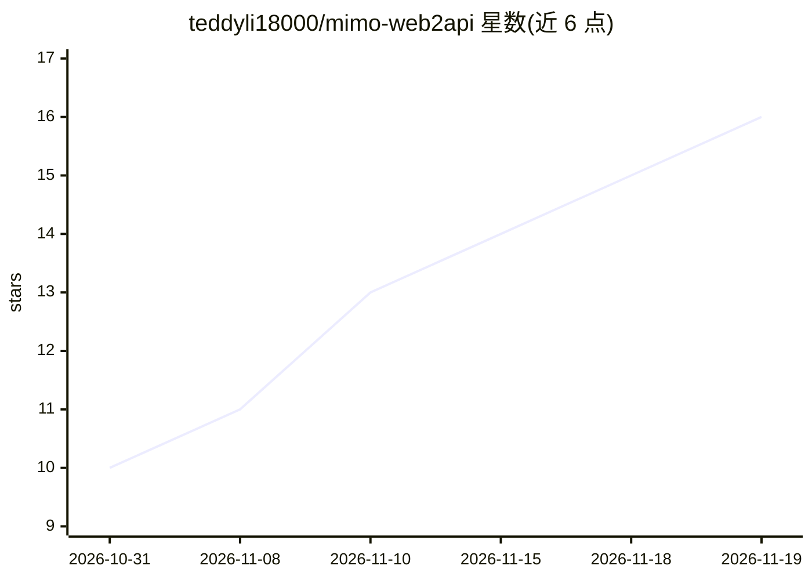

# teddyli18000/mimo-web2api

⭐ 16 · Go · MIT · 推送 2026-11-12 · [GitHub](https://github.com/teddyli18000/mimo-web2api) · 个人维护 · 中文 README

**将小米 MiMo 网页端反代为 OpenAI/Anthropic 兼容 API 的本地网关**

Go 编译的单二进制本地网关，把 aistudio.xiaomimimo.com 网页对话封装为 /v1/chat/completions、/v1/responses、/v1/messages 三种协议端点，供 OpenAI/Anthropic 兼容客户端（Cherry Studio、Claude Code、Cline、SillyTavern 等）以自己账号 Cookie 调用 MiMo 模型。机制含会话复用（增量发送）、三种协议的工具调用、真流式转发、多账号轮转与自愈、思考模式映射、上下文压缩、提示词清洗，内置管理面板与配套浏览器扩展。限制：依赖用户自有 Cookie，仅供个人学习研究，上游协议变更无 SLA；凭据加密落盘本机。

## 筛选速览

| 维度 | 判定 | 备注 |
|---|---|---|
| AI 角色 | `ai-ecosystem` | LLM/agent 周边工具 |
| 许可风险 | `permissive` | MIT |
| 部署形态 | `desktop` | 安装包/桌面程序 |
| 模型依赖 | — | README 未给出锁定关系 |
| 硬件要求 | — | 无带数字的原话,不猜 |
| 安装摩擦 | `medium` | 含编译或系统依赖之一 |
| 成熟度 | — | 结构信号不足 |

## 能力要点

- OpenAI /v1/chat/completions、/v1/responses 与 Anthropic /v1/messages 三协议端点，均含流式与工具调用
- 会话复用增量发送：后续轮次只发新消息，依赖上游服务端上下文
- 多账号轮转与自愈（401/403/451 即时摘除、冷却半开试探）
- 附带浏览器扩展一键同步登录态；JSONL 结构化日志与用量管理面板

## 适用场景

- 让 Cherry Studio / ChatBox / Claude Code / Cline 等客户端直接调用 MiMo 模型
- 多账号分担个人调用负载并自动剔除失效账号
- 长 agent 会话靠增量发送避免撞上游长度限制

## 场景标签

`模型网关` · 领域:Agent 开发

## 证据(README 行号)

> L11: A local gateway that reverse-proxies aistudio.xiaomimimo.com into OpenAI (`/v1/chat/completions`) and Anthropic (`/
> L26: 把 aistudio.xiaomimimo.com 网页对话封装成标准 OpenAI / Anthropic API 的本地网关。配好你自己的小米账号 Cookie 后，任何支持 OpenAI 格式的客户端都能调用 MiMo 模型

## 星数曲线

2026-10-31 10 → 2026-11-19 16（+6）

---
*卡片 v1 · prompt 1.4 · 生成 2026-11-18 · 置信度 mid · 依据 README sha `5db2b02adfb9` · [字段定义](../../DATASET.md)*
