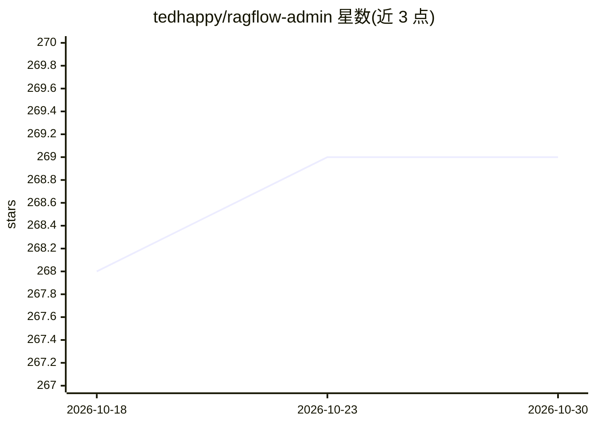

# tedhappy/ragflow-admin

⭐ 269 · TypeScript · Apache-2.0 · 推送 2026-03-12 · [GitHub](https://github.com/tedhappy/ragflow-admin) · 个人维护 · 中文 README

**RAGFlow 的独立后台管理控制台，批量管理知识库与用户**

基于 RAGFlow 二次开发的独立管理控制台，通过 Web 界面集中管理数据集、文档、聊天助手、智能体、用户与团队关系。针对 RAGFlow 内置界面在批量操作、任务队列可见性、用户管理上的限制，提供跨数据集仪表盘、批量上传/解析/删除、实时任务队列监控与服务健康检查。后端为 Python/Quart 并通过 ragflow-sdk 对接 RAGFlow（需 v0.15+ 实例），前端为 React 18；团队关系功能需 MySQL 访问。支持 Docker Compose 部署与源码部署两种方式，界面支持中英双语。

## 筛选速览

| 维度 | 判定 | 备注 |
|---|---|---|
| AI 角色 | `ai-ecosystem` | LLM/agent 周边工具 |
| 许可风险 | `permissive` | Apache-2.0 |
| 部署形态 | `self-host` | docker 或自建部署 |
| 模型依赖 | — | README 未给出锁定关系 |
| 硬件要求 | — | 无带数字的原话,不猜 |
| 安装摩擦 | `low` | 无编译、无系统依赖或容器化 |
| 成熟度 | — | 结构信号不足 |

## 能力要点

- 跨数据集批量上传、解析、停止与删除操作
- 全局任务队列实时监控（队列位置与进度）
- 用户与团队关系集中管理（需 MySQL 访问）
- 服务健康检查与使用统计仪表盘

## 适用场景

- 生产环境统一管理多个 RAGFlow 知识库与文档
- 监控 RAGFlow 解析任务队列与批量控制
- 集中管理 RAGFlow 用户、团队与聊天助手

## 场景标签

 · 领域:LLM 基础设施/RAG 管理

## 证据(README 行号)

> L20: A standalone administration console for RAGFlow
> L24: **RAGFlow Admin** is a lightweight, standalone administration console for RAGFlow — the leading open-source RAG eng
> L44: |**📚 Dataset Management**|View all datasets across users, create, delete with batch operations|

## 星数曲线

2026-10-18 268 → 2026-10-30 269（+1）

---
*卡片 v1 · prompt 1.4 · 生成 2026-10-22 · 置信度 mid · 依据 README sha `1514bed65e21` · [字段定义](../../DATASET.md)*
