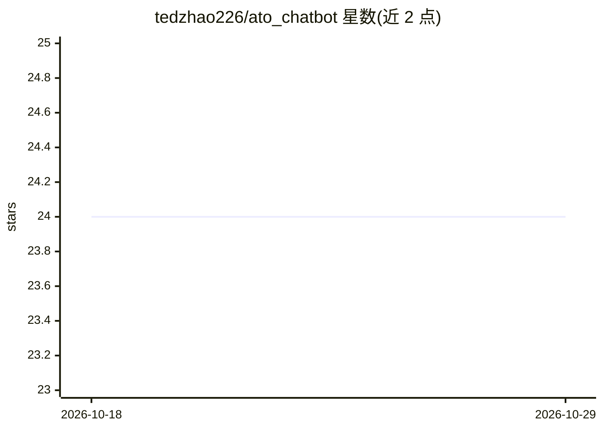

# tedzhao226/ato_chatbot

⭐ 24 · Python · Apache-2.0 · 推送 2026-06-26 · [GitHub](https://github.com/tedzhao226/ato_chatbot) · [官网](https://ato-chat.streamlit.app/) · 个人维护

**面向澳大利亚税务局信息的 RAG 聊天机器人（LlamaIndex + OpenAI）**

从 ato.gov.au 抓取并处理内容、用 Qdrant 存储向量索引，再通过 Streamlit 聊天界面以三步 RAG 流程（查询改写、知识检索、OpenAI 生成）回答澳大利亚税务相关问题。数据处理与索引构建由 ZenML 管道编排，Firecrawl 负责网页抓取，Docker Compose 启动依赖服务，MongoDB 做文档存储。提供在线演示站点。需 Python 3.12+、OpenAI API key，属特定领域问答应用而非通用框架。

## 筛选速览

| 维度 | 判定 | 备注 |
|---|---|---|
| AI 角色 | `ai-native` | 本体是模型或模型工具 |
| 许可风险 | `permissive` | Apache-2.0 |
| 部署形态 | `self-host` | docker 或自建部署 |
| 模型依赖 | — | README 未给出锁定关系 |
| 硬件要求 | — | 无带数字的原话,不猜 |
| 安装摩擦 | `low` | 无编译、无系统依赖或容器化 |
| 成熟度 | — | 结构信号不足 |

## 能力要点

- ZenML 编排的抓取-清洗-索引数据管道（Firecrawl + Qdrant）
- Streamlit 聊天界面实现三步 RAG：查询改写、检索、生成
- 提供 Streamlit Cloud 在线演示
- Make 命令驱动管道运行与服务启动

## 适用场景

- 查询澳大利亚税务局（ATO）相关税务信息
- 作为领域 RAG 应用的参考实现
- 学习 ZenML + LlamaIndex + Qdrant 的端到端管道构建

## 场景标签

`聊天机器人` `RAG` · 领域:对话与助手

## 证据(README 行号)

> L3: A RAG-based chatbot system for Australian Taxation Office (ATO) information retrieval and assistance, powered by dat
> L13: This project implements a Retrieval-Augmented Generation (RAG) chatbot system specifically designed for ATO-related
> L64: 1. **Query Rephrasing**: Improves query understanding

## 星数曲线

2026-10-18 24 → 2026-10-29 24（+0）

---
*卡片 v1 · prompt 1.4 · 生成 2026-10-27 · 置信度 high · 依据 README sha `a81d0d3a2462` · [字段定义](../../DATASET.md)*
