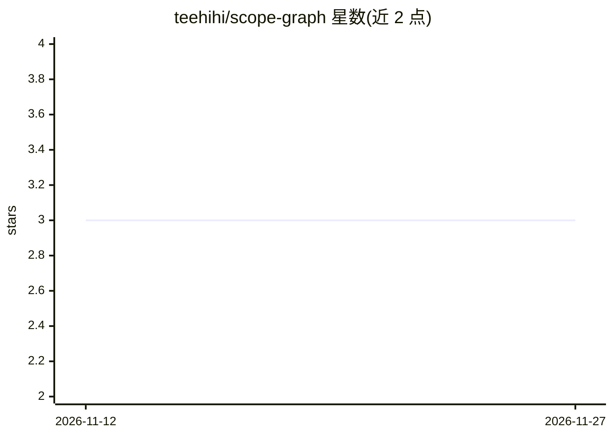

# teehihi/scope-graph

⭐ 3 · TypeScript · MIT · 推送 2026-11-11 · [GitHub](https://github.com/teehihi/scope-graph) · [官网](https://www.scopegraph.top) · 个人维护

**AI 辅助开发的代码变更影响分析工具，附依赖图与 MCP 工具**

面向 AI 辅助开发的变更影响分析应用：将变更需求映射到已索引代码库，基于 Python AST 索引（TypeScript/JavaScript 用正则提取符号，无 Go 索引）、混合检索与图遍历，输出直接/间接/潜在影响的分类报告，附文件路径、符号与带行号的源码摘录。提供 React 依赖图可视化、FastMCP 工具（analyze_change 等三项）、语音需求输入与截图上传，以及复制给 Cursor/Claude Code 的 agent 提示词。带 Stripe 订阅分级（免费/Plus/Pro）限制 AI 用量；生产环境强制 multi_ai 推理配置，Baseten/Modal 线上推理自述未经验证。

## 筛选速览

| 维度 | 判定 | 备注 |
|---|---|---|
| AI 角色 | `ai-native` | 本体是模型或模型工具 |
| 许可风险 | `permissive` | MIT |
| 部署形态 | `self-host` | docker 或自建部署 |
| 模型依赖 | — | README 未给出锁定关系 |
| 硬件要求 | — | 无带数字的原话,不猜 |
| 安装摩擦 | `low` | 无编译、无系统依赖或容器化 |
| 成熟度 | — | 结构信号不足 |

## 能力要点

- Python AST 索引 + 图遍历的变更影响报告，区分直接/间接/潜在影响
- 证据门机制：拒绝指向未索引文件/符号的引用，附带行号源码摘录
- FastMCP 工具（analyze_change、get_relevant_context、suggest_tests）供 AI agent 调用
- 8+ 语言语音需求输入与 PNG/JPEG 截图多模态上传

## 适用场景

- 改动前评估变更的波及范围与下游风险
- 为 AI 编码助手提供带源码证据的影响上下文
- 以 MCP 工具让 agent 查询索引代码库的相关上下文与建议测试

## 场景标签

`代码审查` `RAG` · 领域:编码与开发

## 证据(README 行号)

> L52: ScopeGraph is a **planning aid**. Static indexing supplies facts; model reasoning proposes relationships; developer
> L65: |Agent access|FastMCP tools: `analyze_change`, `get_relevant_context`, `suggest_tests`|
> L7: **ScopeGraph maps a change request to an indexed codebase, then shows the evidence behind its proposed blast radius.

## 星数曲线

2026-11-12 3 → 2026-11-27 3（+0）

---
*卡片 v1 · prompt 1.4 · 生成 2026-11-21 · 置信度 mid · 依据 README sha `b80faa8aeedf` · [字段定义](../../DATASET.md)*
