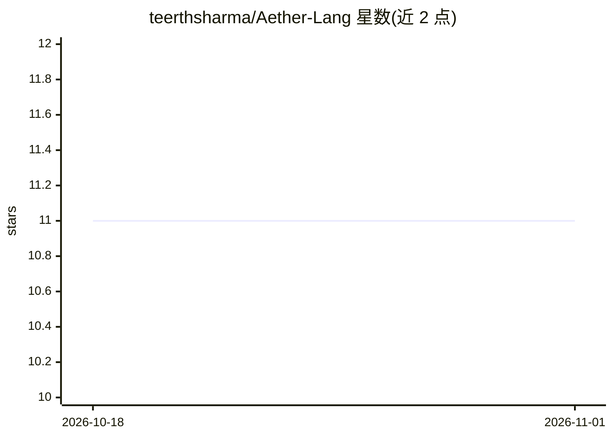

# teerthsharma/Aether-Lang

⭐ 11 · Rust · NOASSERTION · 推送 2026-10-31 · [GitHub](https://github.com/teerthsharma/Aether-Lang) · [官网](https://teerthsharma.github.io/Aether-Lang/) · 个人维护

**以拓扑为决策机制的编程语言：持久同调内置、带证明输出**

Rust 实现的领域编程语言 Aether，将持久同调（Betti 数）作为一等语言构造，`seal` 循环以形状不变量而非浮点容差作为停止条件。提供 Takens 延迟嵌入、Vietoris–Rips 过滤、环绕数、认证 argmin/top-k、Lyapunov 谱、对称群恢复等运算，答案附带误差界证明，无法证明时返回类型化拒绝而非默认值。数学核心经 Lean 4 形式化（48 定理、0 sorry），no_std 支持 Cortex-M3 与裸 x86_64。README 自述前提未经实测、未与 ripser/GUDHI 做外部对齐、GPU 后端未接线。

## 筛选速览

| 维度 | 判定 | 备注 |
|---|---|---|
| AI 角色 | `ai-ecosystem` | LLM/agent 周边工具 |
| 许可风险 | `none` | NOASSERTION |
| 部署形态 | `None` |  |
| 模型依赖 | — | README 未给出锁定关系 |
| 硬件要求 | — | 无带数字的原话,不猜 |
| 安装摩擦 | `low` | 无编译、无系统依赖或容器化 |
| 成熟度 | `idea` | |

## 能力要点

- 持久同调内置语言，seal 循环按 Betti 数不变量停止
- 决策附带误差界证明，无法证明时返回类型化拒绝
- Lean 4 形式化核心：48 定理、0 sorry；428 测试、52/52 变异被捕获
- no_std Rust 核心，可构建到 Cortex-M3 与裸 x86_64

## 适用场景

- 用形状事件而非浮点容差控制训练/仿真循环终止
- 对时序或点云数据计算 Betti 数、持久条码与环绕数等拓扑量
- 需要带证明的 argmin/top-k/阈值判定，拒绝未证结论

## 场景标签

 · 领域:编程语言/拓扑机器学习

## 证据(README 行号)

> L28: Aether decides with shape. Persistent homology is built into the language. Its output, the Betti numbers of a cloud
> L54: 3. **Features are born and die.** Pieces merge. Loops appear, then get filled in. Each feature's lifetime is a bar:

## 星数曲线

2026-10-18 11 → 2026-11-01 11（+0）

---
*卡片 v1 · prompt 1.4 · 生成 2026-11-01 · 置信度 mid · 依据 README sha `57a981bd0f0f` · [字段定义](../../DATASET.md)*
