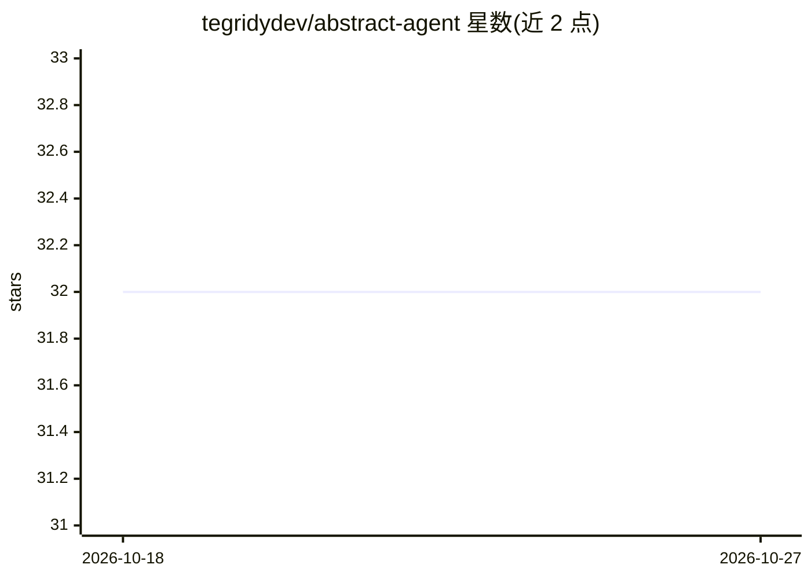

# tegridydev/abstract-agent

⭐ 32 · Python · MIT · 推送 2026-09-13 · [GitHub](https://github.com/tegridydev/abstract-agent) · 个人维护

**本地模型驱动的科研假设生成工具：检索文献并产出提案**

面向研究者的 Python 本地工具：围绕选定主题在 arXiv、Semantic Scholar、PubMed 等 10 个学术数据源检索，构建证据卡片，再调用本地 Ollama 模型（如 gemma3:4b）完成候选构想的生成、评审、修订与最接近在先工作的检索，最终输出提案或带中止原因的证据记录。流程分为规划、生成、评审、写作四个环节，各环节可指定不同模型。默认证据门槛为两个 facet 下六篇相关文献。文献查询会出网，推理在本地 Ollama 时不出机器；结果以 JSON 与文本保存。README 明确提示产出的提案仍需人工核查。

## 筛选速览

| 维度 | 判定 | 备注 |
|---|---|---|
| AI 角色 | `ai-native` | 本体是模型或模型工具 |
| 许可风险 | `permissive` | MIT |
| 部署形态 | `library` | 以包/库形式分发 |
| 模型依赖 | local-ok | 支持本地模型 |
| 硬件要求 | — | 无带数字的原话,不猜 |
| 安装摩擦 | `low` | 无编译、无系统依赖或容器化 |
| 成熟度 | — | 结构信号不足 |

## 能力要点

- 10 个学术检索适配器（arXiv/Semantic Scholar/PubMed/OpenAlex 等）
- 证据卡片机制，默认门槛为两 facet 下 6 篇相关文献
- 规划/生成/评审/写作可分别指定不同本地模型
- 每次运行保留证据、模型指标、警告等完整记录

## 适用场景

- 围绕研究主题梳理在先文献并生成候选研究假设
- 在本地模型上完成假设的生成与评审流程
- 回溯一次研究探索中检索到了什么、模型在哪卡住

## 场景标签

`科研工具` · 领域:学习与行业

## 证据(README 行号)

> L6: Abstract Agent searches scholarly sources, builds an evidence record and asks local models to
> L49: 1. Search the topic and related facets across the scholarly providers.

## 星数曲线

2026-10-18 32 → 2026-10-27 32（+0）

---
*卡片 v1 · prompt 1.4 · 生成 2026-10-25 · 置信度 high · 依据 README sha `97f1535583bf` · [字段定义](../../DATASET.md)*
