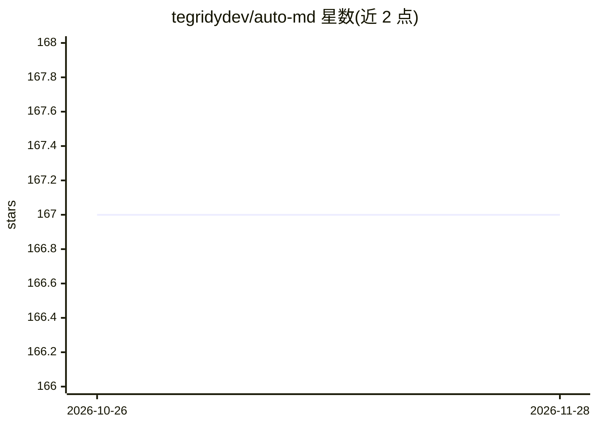

# tegridydev/auto-md

⭐ 167 · Python · MIT · 推送 2026-11-23 · [GitHub](https://github.com/tegridydev/auto-md) · 个人维护

**把代码库/文档转换为 Markdown 与 RAG 就绪数据包的本地工具**

在本地运行的 Web 应用：读取本地文件/文件夹、公开 GitHub 仓库、网页、ZIP/TAR 压缩包及 DOCX/PDF/图像等格式，通过 `.gitignore` 与 `.automdignore` 过滤依赖与构建产物，输出单个干净 Markdown（含来源标注、锚点与目录）或 RAG 就绪 ZIP（chunks.jsonl 与 manifest.json）。分块按标题、段落、页与代码边界进行，token 数为确定性估算。通过 uv 启动，服务仅绑定回环地址，运行时无需 API key、云服务或 Node.js。

## 筛选速览

| 维度 | 判定 | 备注 |
|---|---|---|
| AI 角色 | `ai-ecosystem` | LLM/agent 周边工具 |
| 许可风险 | `permissive` | MIT |
| 部署形态 | `None` |  |
| 模型依赖 | — | README 未给出锁定关系 |
| 硬件要求 | — | 无带数字的原话,不猜 |
| 安装摩擦 | `low` | 无编译、无系统依赖或容器化 |
| 成熟度 | — | 结构信号不足 |

## 能力要点

- 输出 RAG 就绪 ZIP：chunks.jsonl（稳定 ID、元数据、哈希）与 manifest.json
- 本地 OCR（RapidOCR）处理扫描 PDF 与图像，运行时无 AI API 调用
- 仅绑定 loopback，无分析统计与 CDN，上传数据任务结束即清除
- 支持 GitHub 仓库指定 ref、嵌套压缩包与 git 风格排除规则

## 适用场景

- 把 GitHub 仓库整理成单个 Markdown 喂给 LLM
- 为自建 RAG 系统准备带元数据的分块数据集
- 将扫描版 PDF 与图像批量转为可检索文本
- 本地离线处理不想上传第三方的代码文档

## 场景标签

`文档解析` · 领域:知识与检索

## 证据(README 行号)

> L3: Auto-MD turns codebases and documents into one clean Markdown file or a RAG ready bundle. It processes your files on
> L42: RAG bundle produces a ZIP containing:

## 星数曲线

2026-10-26 167 → 2026-11-28 167（+0）

---
*卡片 v1 · prompt 1.4 · 生成 2026-11-27 · 置信度 high · 依据 README sha `b80f64dea95c` · [字段定义](../../DATASET.md)*
