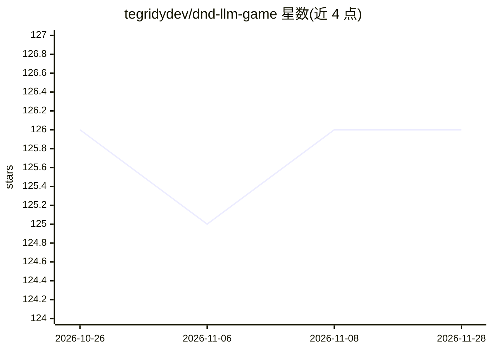

# tegridydev/dnd-llm-game

⭐ 126 · Python · NOASSERTION · 推送 2026-11-24 · [GitHub](https://github.com/tegridydev/dnd-llm-game) · 个人维护

**本地多 LLM 扮演 AI 地下城主的单人 D&D 游戏**

单人 D&D 风格游戏：玩家创建队伍、选择行动并对不确定结果掷骰，游戏本身管理骰子、战斗、资源与进度，模型负责叙事世界与提出剧情更新。默认使用本地 Ollama（llama3.2 3b/1b 与 nomic-embed-text），支持通过 .env 配置切换多种本地与托管 Provider。带战役工作区、PDF 传说资料库（LanceDB+SQLite 索引）、存档备份与完整性检查工具。需安装 uv、Bun 与 Node.js 24 运行。

## 筛选速览

| 维度 | 判定 | 备注 |
|---|---|---|
| AI 角色 | `ai-native` | 本体是模型或模型工具 |
| 许可风险 | `none` | NOASSERTION |
| 部署形态 | `None` |  |
| 模型依赖 | local-ok | 支持本地模型 |
| 硬件要求 | — | 无带数字的原话,不猜 |
| 安装摩擦 | `low` | 无编译、无系统依赖或容器化 |
| 成熟度 | — | 结构信号不足 |

## 能力要点

- 游戏负责规则引擎（骰子/战斗/资源/进度），LLM 负责叙事与剧情提案
- 默认本地 Ollama 运行，聊天/工具/嵌入可分模型配置
- 支持多种本地运行时（Ollama/LM Studio/llama.cpp/vllm/localai/koboldcpp）与托管端点
- PDF 传说资料上传、索引与检索，战役数据存于本地 data/ 目录

## 适用场景

- 在本地设备上玩有 AI 地下城主的单人 D&D
- 上传自己的 PDF 设定资料让模型引用其内容
- 配置多家托管模型作为地下城主，远程调用时用 LLM_ALLOW_REMOTE 控制

## 场景标签

`RAG` · 领域:知识与检索

## 证据(README 行号)

> L3: A solo D&D inspired game with an AI Dungeon Master. Create a party, choose how to act and roll for uncertain outcome
> L19: The default is local Ollama. Start it first and pull these models if you want the defaults.

## 星数曲线

2026-10-26 126 → 2026-11-28 126（+0）

---
*卡片 v1 · prompt 1.4 · 生成 2026-11-28 · 置信度 high · 依据 README sha `66cbc07de4ba` · [字段定义](../../DATASET.md)*
