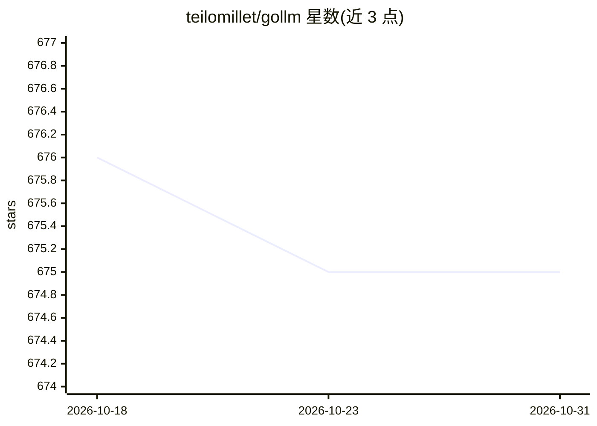

# teilomillet/gollm

⭐ 675 · Go · Apache-2.0 · 推送 2026-03-21 · [GitHub](https://github.com/teilomillet/gollm) · [官网](https://docs.gollm.co) · 个人维护

**Go 统一 LLM 接口库：一套 API 接多家模型服务商**

面向 Go 开发者的 LLM 编程库：用统一 API 接入 OpenAI、Anthropic、Groq、Ollama、Mistral、OpenRouter 等服务商，可通过选项或环境变量切换供应商与模型。提供提示词工程（上下文/指令/输出格式选项）、提示词优化器、JSON 结构化输出校验、记忆保留与结构化消息缓存（含 Anthropic prompt caching）、ChainOfThought 等预置函数，以及跨供应商模型比较工具。含内置重试机制与可扩展架构。

## 筛选速览

| 维度 | 判定 | 备注 |
|---|---|---|
| AI 角色 | `ai-ecosystem` | LLM/agent 周边工具 |
| 许可风险 | `permissive` | Apache-2.0 |
| 部署形态 | `None` |  |
| 模型依赖 | local-ok | 支持本地模型 |
| 硬件要求 | — | 无带数字的原话,不猜 |
| 安装摩擦 | `low` | 无编译、无系统依赖或容器化 |
| 成熟度 | — | 结构信号不足 |

## 能力要点

- 统一 API 接入 OpenAI/Anthropic/Groq/Ollama/Mistral/OpenRouter
- 提示词优化器支持自定义指标与评分体系
- JSON schema 生成与结构化输出校验
- 跨供应商模型性能比较与 Mixture of Agents

## 适用场景

- 在 Go 项目中用同一套代码切换不同 LLM 供应商
- 自动优化提示词并对比不同模型表现
- 生成并校验结构化 JSON 输出

## 场景标签

`模型网关` `提示工程` · 领域:Agent 开发

## 证据(README 行号)

> L17: - **Unified API for Multiple LLM Providers:** Interact seamlessly with various providers, including OpenAI, Anthrop
> L59: go get github.com/teilomillet/gollm

## 星数曲线

2026-10-18 676 → 2026-10-31 675（-1）

---
*卡片 v1 · prompt 1.4 · 生成 2026-10-21 · 置信度 high · 依据 README sha `96f229e2f988` · [字段定义](../../DATASET.md)*
