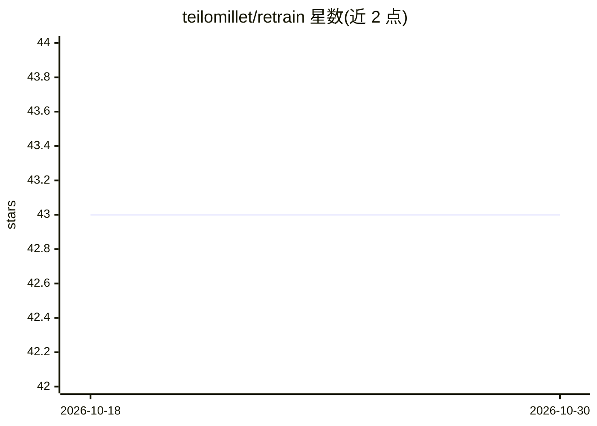

# teilomillet/retrain

⭐ 43 · Python · 推送 2026-07-12 · [GitHub](https://github.com/teilomillet/retrain) · [官网](https://retrain.readthedocs.io/en/latest/) · 个人维护

**TOML 配置驱动的 LLM 强化学习（RLVR）训练框架**

面向 LLM 强化学习实验的 Python 库与 CLI：以 TOML 配置为核心，覆盖 config -> dry-run 解释 -> 训练 -> 日志检查的实验循环。支持 GRPO/MaxRL 等优势估计与 GTPO/HICRA/SEPA 可组合管线、可插拔后端与推理引擎、可插拔奖励（match/math/judge/自定义）、单文件 campaign 扫描、LoRA-Squeeze 压缩分析与断点恢复。提供模板初始化、插件机制与内置手册命令。要求 Python 3.12+，通过 uv tool 或 pip 安装。

## 筛选速览

| 维度 | 判定 | 备注 |
|---|---|---|
| AI 角色 | `ai-ecosystem` | LLM/agent 周边工具 |
| 许可风险 | `none` | — |
| 部署形态 | `library` | 以包/库形式分发 |
| 模型依赖 | — | README 未给出锁定关系 |
| 硬件要求 | — | 无带数字的原话,不猜 |
| 安装摩擦 | `low` | 无编译、无系统依赖或容器化 |
| 成熟度 | — | 结构信号不足 |

## 能力要点

- TOML-first 配置与 explain/status/doctor 等 CLI 工具
- 可组合优势管线（GRPO/MaxRL + GTPO/HICRA/SEPA）与可插拔后端、奖励、插件
- 单 TOML 文件驱动的 campaign 扫描与断点恢复
- LoRA-Squeeze rank 分析与压缩

## 适用场景

- 用可验证奖励（RLVR）对 LLM 做强化学习训练
- 在一份 TOML 中组织多配置训练扫描并对比结果
- 通过插件扩展优势函数、transform 与自定义奖励

## 场景标签

`强化学习` `模型量化` · 领域:训练与推理

## 证据(README 行号)

> L3: `retrain` is a TOML-first RLVR (Reinforcement Learning with Verifiable Rewards) trainer for LLMs, built to make expe
> L106: - Composable advantage pipeline: GRPO/MaxRL + GTPO/HICRA/SEPA
> L107: - Pluggable backends and inference engines

## 星数曲线

2026-10-18 43 → 2026-10-30 43（+0）

---
*卡片 v1 · prompt 1.4 · 生成 2026-10-25 · 置信度 high · 依据 README sha `65699fcc982f` · [字段定义](../../DATASET.md)*
