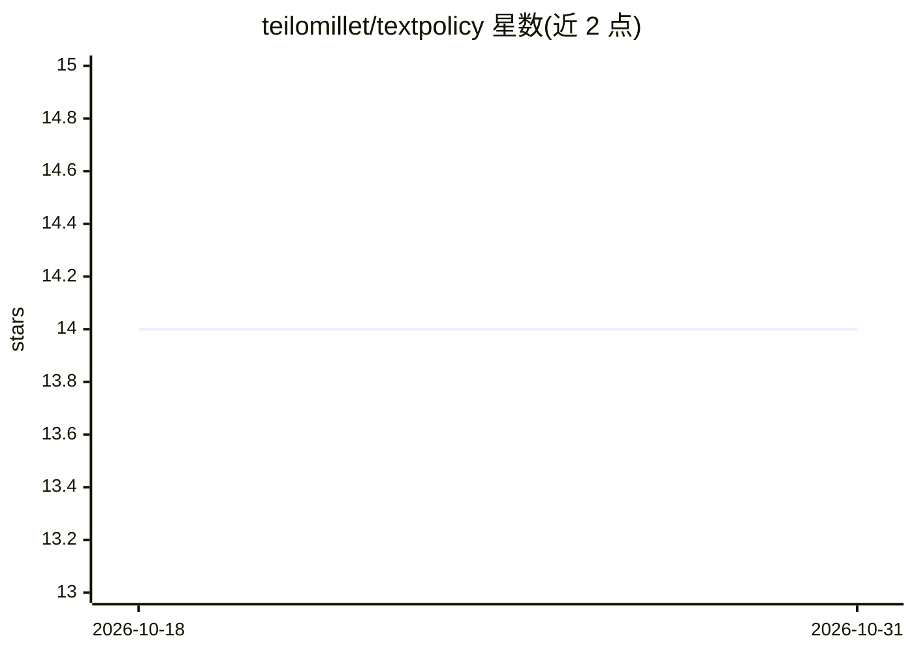

# teilomillet/textpolicy

⭐ 14 · Python · MIT · 推送 2026-02-15 · [GitHub](https://github.com/teilomillet/textpolicy) · 个人维护

**Apple Silicon 上基于 MLX 的文本生成强化学习工具包**

TextPolicy 是面向 Apple Silicon MLX 框架的文本生成强化学习工具包：提供 GRPO/GSPO 算法、文本生成环境、rollout 运行器、带装饰器注册的奖励函数机制，以及 LoRA/QLoRA 工具。通过 uv 安装，模型加载依赖 mlx-lm（可选依赖），生成需要模型与 tokenizer，仅做奖励计算时可不加载模型。另支持经 Tinker API 在 GPU 上运行 advantage 流水线，附带 12 个示例与文档。

## 筛选速览

| 维度 | 判定 | 备注 |
|---|---|---|
| AI 角色 | `ai-ecosystem` | LLM/agent 周边工具 |
| 许可风险 | `permissive` | MIT |
| 部署形态 | `library` | 以包/库形式分发 |
| 模型依赖 | — | README 未给出锁定关系 |
| 硬件要求 | — | 无带数字的原话,不猜 |
| 安装摩擦 | `low` | 无编译、无系统依赖或容器化 |
| 成熟度 | — | 结构信号不足 |

## 能力要点

- 提供 GRPO/GSPO 强化学习算法
- 带装饰器注册的奖励函数与文本生成环境
- LoRA/QLoRA/TinyLoRA 工具与配置示例
- 支持经 Tinker API 在 GPU 上训练

## 适用场景

- 在 Mac 上对 MLX 语言模型做 GRPO/GSPO 训练
- 用自定义奖励函数优化文本生成行为（如长度控制、推理任务）
- 通过 LoRA/QLoRA 降低训练参数量

## 场景标签

`强化学习` `微调` · 领域:训练与推理

## 证据(README 行号)

> L3: Reinforcement learning toolkit for text generation on MLX (Apple Silicon).
> L4: TextPolicy provides algorithms (GRPO/GSPO), text-generation environments, a rollout runner,

## 星数曲线

2026-10-18 14 → 2026-10-31 14（+0）

---
*卡片 v1 · prompt 1.4 · 生成 2026-10-31 · 置信度 high · 依据 README sha `1d034f0bccb8` · [字段定义](../../DATASET.md)*
