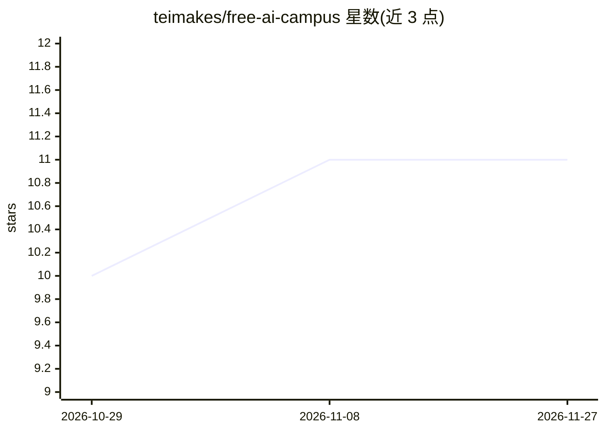

# teimakes/free-ai-campus

⭐ 11 · Unlicense · 推送 2026-11-23 · [GitHub](https://github.com/teimakes/free-ai-campus) · 个人维护

**面向韩国学习者的 ML/DL·LLM·Agent 免费公开课策展清单**

一个韩语/英语的 ML·DL·LLM·AI Agent 公开讲座与实资料聚合仓库：收录韩国高校（首尔大、高丽大、KAIST）、韩国企业（Upstage、AIFactory）与海外高校（Stanford、MIT、CMU、Berkeley）及企业（OpenAI、Anthropic、Hugging Face、Microsoft）的课程链接，按

## 筛选速览

| 维度 | 判定 | 备注 |
|---|---|---|
| AI 角色 | `ai-knowledge` | 知识聚合/清单类 |
| 许可风险 | `permissive` | Unlicense |
| 部署形态 | `None` |  |
| 模型依赖 | — | README 未给出锁定关系 |
| 硬件要求 | — | 无带数字的原话,不猜 |
| 安装摩擦 | `low` | 无编译、无系统依赖或容器化 |
| 成熟度 | — | 结构信号不足 |

## 能力要点

- 三条 from scratch 学习路径，各配 9 门大学公开课顺序与动手任务
- 韩语/英语双语的课程·笔记·代码资源目录
- 为部分资料提供韩语学习指南（前置知识、实目标）
- YouTube 频道专栏收录 Karpathy、Raschka 等 from scratch 实教程

## 适用场景

- 为 ML/DL 或 LLM 从零学习挑选大学公开课顺序
- 找带韩语指南的强化学习、Agent 实课程
- 检索韩国高校与韩国 AI 企业的公开讲座资源

## 场景标签

`教程课程` `精选清单` · 领域:学习与行业

## 证据(README 行号)

> L3: **무료로 공개된 강의·노트·코드를 모았습니다.**
> L11: ML/DL from scratch, LLM from scratch, AI Agent from scratch: 대학 공개강의 9개로 고른 세 학습 경로

## 星数曲线

2026-10-29 10 → 2026-11-27 11（+1）

---
*卡片 v1 · prompt 1.4 · 生成 2026-11-18 · 置信度 high · 依据 README sha `d03449054051` · [字段定义](../../DATASET.md)*
