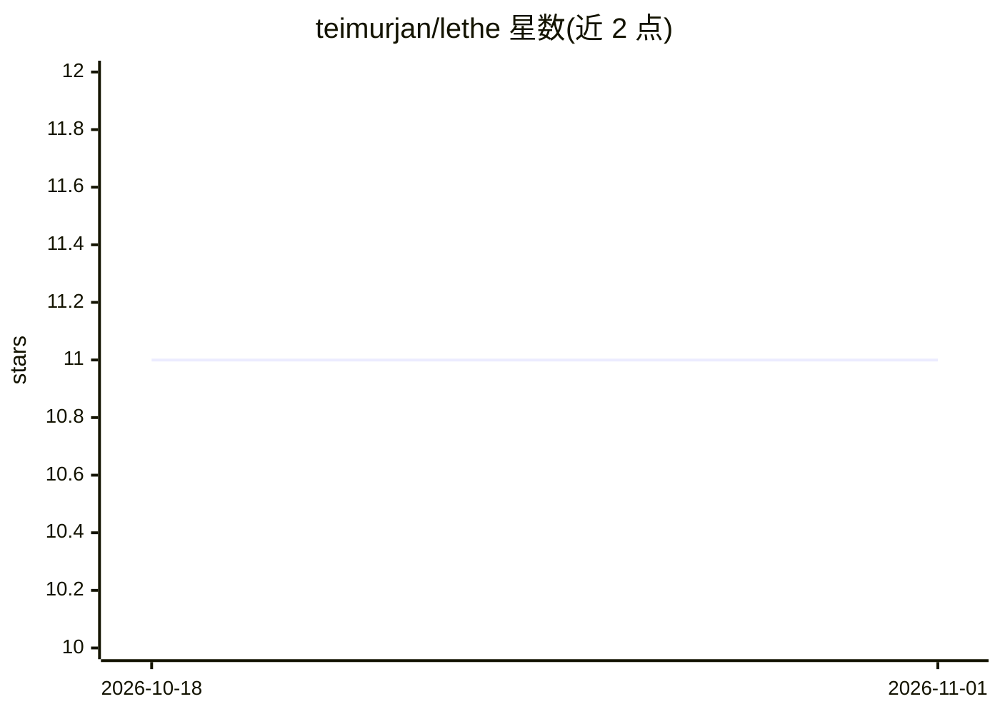

# teimurjan/lethe

⭐ 11 · Rust · MIT · 推送 2026-07-16 · [GitHub](https://github.com/teimurjan/lethe) · [官网](https://pypi.org/project/lethe-memory/) · 个人维护

**面向 LLM agent 的记忆存储：混合检索与遗忘机制**

为 LLM agent 提供长期记忆存储：混合 BM25 + 稠密向量检索（RRF 融合）、cross-encoder 重排序、聚类式检索诱导遗忘（RIF）与可选的写入时 LLM 增强层。通过检索反馈识别长期干扰条目，无需微调。提供 Rust CLI（含 TUI）、Python 与 Node SDK，可自动发现并索引 Claude Code、Codex、Oh My Pi 的会话转录，并以插件形式为这些编码 agent 注入 recall 技能。附 LongMemEval-S 基准结果；作者注明 RIF 在 NFCorpus（医学 IR）上出现回退，属工作负载相关设计。

## 筛选速览

| 维度 | 判定 | 备注 |
|---|---|---|
| AI 角色 | `ai-ecosystem` | LLM/agent 周边工具 |
| 许可风险 | `permissive` | MIT |
| 部署形态 | `library` | 以包/库形式分发 |
| 模型依赖 | — | README 未给出锁定关系 |
| 硬件要求 | — | 无带数字的原话,不猜 |
| 安装摩擦 | `low` | 无编译、无系统依赖或容器化 |
| 成熟度 | — | 结构信号不足 |

## 能力要点

- 混合 BM25 + 稠密检索（RRF）+ cross-encoder 重排序
- 聚类式检索诱导遗忘（RIF），无需微调的干扰项抑制
- 自动索引 Claude Code / Codex / Oh My Pi 转录并提供插件 recall 技能
- Rust CLI / TUI、Python、Node 三种使用形态

## 适用场景

- 为我的编码 agent 提供跨项目长期记忆与检索
- 在 Claude Code 或 Codex 内直接 recall 历史会话内容
- 对 agent 会话记录做去重与定期压缩管理

## 场景标签

`Agent 记忆` · 领域:Agent 开发

## 证据(README 行号)

> L5: A memory store for LLM agents that **gets better the more you use it**. Hybrid BM25 + dense retrieval, cross-encoder
> L42: The CLI works on its own. Install a plugin only if you want `recall` and
> L84: pip install lethe-memory

## 星数曲线

2026-10-18 11 → 2026-11-01 11（+0）

---
*卡片 v1 · prompt 1.4 · 生成 2026-11-01 · 置信度 high · 依据 README sha `aa9ec42b6521` · [字段定义](../../DATASET.md)*
