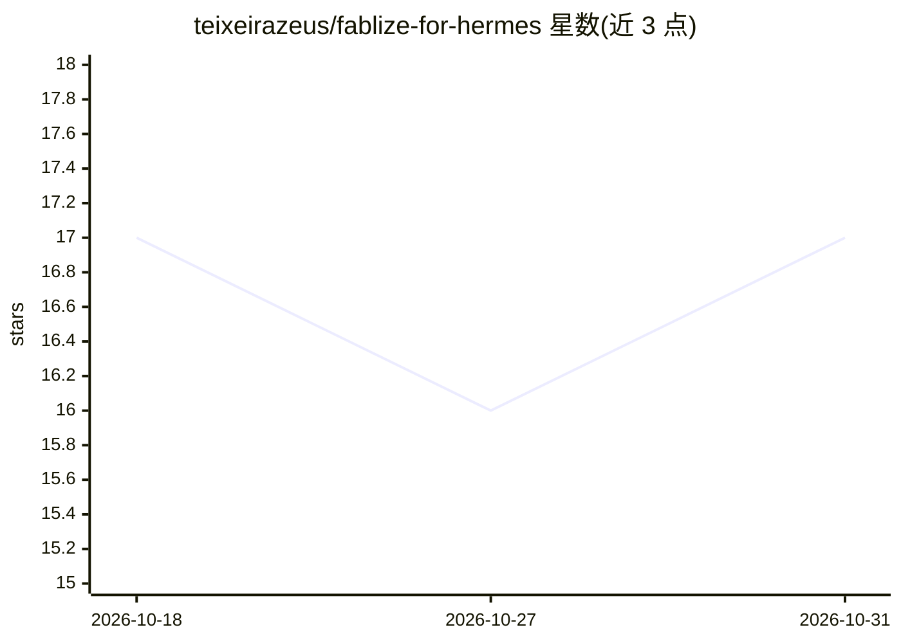

# teixeirazeus/fablize-for-hermes

⭐ 17 · Python · MIT · 推送 2026-06-17 · [GitHub](https://github.com/teixeirazeus/fablize-for-hermes) · 个人维护

**把 fablize 验证式工作流程移植为 Hermes Agent 技能**

将 fablize（原为 Claude Code 插件）的已验证流程移植到 Hermes Agent 技能系统：包括验证落地（运行并观察产物）、多故事任务分解与证据门控、系统化调试协议、防提前停止。提供 Hermes 技能文件（SKILL.md）、仅用标准库的目标引擎脚本 goals.py（状态持久化于 ~/.hermes/fablize/）、上下文纪律 packs 与安装脚本。README 明确列出不可转移项（模型能力上限）与诚实限制：早期停止依赖 agent 自我执行而非确定性钩子。

## 筛选速览

| 维度 | 判定 | 备注 |
|---|---|---|
| AI 角色 | `ai-ecosystem` | LLM/agent 周边工具 |
| 许可风险 | `permissive` | MIT |
| 部署形态 | `None` |  |
| 模型依赖 | — | README 未给出锁定关系 |
| 硬件要求 | — | 无带数字的原话,不猜 |
| 安装摩擦 | `low` | 无编译、无系统依赖或容器化 |
| 成熟度 | — | 结构信号不足 |

## 能力要点

- Hermes Agent 技能形式的行为规则集（基础规则、多故事循环、深度调查、验证落地）
- 仅标准库的 goals.py 多故事分解与验证门控，状态跨会话持久化
- setup.sh 安装技能并可注入 AGENTS.md/CLAUDE.md 操作块
- 明确区分可转移流程与不可转移的模型能力

## 适用场景

- 让 Hermes Agent 执行多故事任务时逐项验证再宣告完成
- 调试场景下按复现→竞争假设→因果链协议推进
- 渲染类产物（HTML/SVG/图表）先运行观察再修复重跑

## 场景标签

 · 领域:AI Agent 工作流/技能

## 证据(README 行号)

> L9: A port of fablize for the Hermes Agent
> L43: ### 1. Hermes Agent skill (`skills/fablize/SKILL.md`)
> L45: The core behavioral ruleset, structured as a Hermes Agent skill (YAML frontmatter +

## 星数曲线

2026-10-18 17 → 2026-10-31 17（+0）

---
*卡片 v1 · prompt 1.4 · 生成 2026-10-30 · 置信度 high · 依据 README sha `94acb581277d` · [字段定义](../../DATASET.md)*
