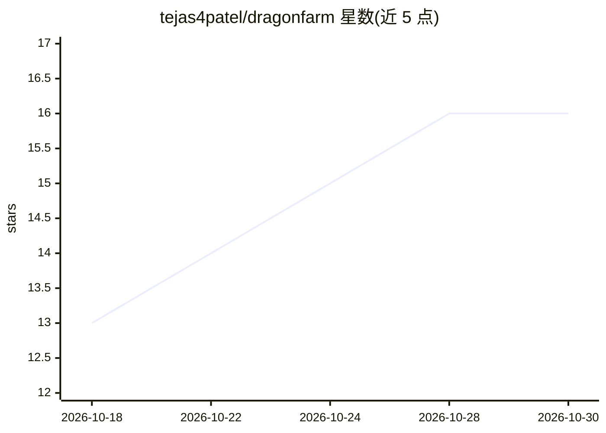

# tejas4patel/dragonfarm

⭐ 16 · R · NOASSERTION · 推送 2026-10-23 · [GitHub](https://github.com/tejas4patel/dragonfarm) · [官网](https://dragonfarm.dev/) · 个人维护

**R 语言的 LLM 微调工具包：用自有文档训练并使用自己的模型**

面向 R/RStudio 用户的本地 LLM 微调工具包：读取 PDF、Word、网页、表格等文档，先通过内置 RAG 问答并附来源，再由模型生成练习问答作为训练数据，用 LoRA/QLoRA 在本地 GPU 或免费云端 GPU 上微调出用户自有的 adapter 或合并模型。每步既是 RStudio add-in/Shiny 应用操作也是 R 函数；训练可在 8GB 显存笔记本上完成（7B 模型 4-bit），内置 Unsloth。另提供运行记录、回放、签核与出站网关等面向受监管团队的功能。需要 R 4.1+ 与约 3GB 磁盘的 Python 环境，首建约 3.7GB。

## 筛选速览

| 维度 | 判定 | 备注 |
|---|---|---|
| AI 角色 | `ai-ecosystem` | LLM/agent 周边工具 |
| 许可风险 | `none` | NOASSERTION |
| 部署形态 | `None` |  |
| 模型依赖 | — | README 未给出锁定关系 |
| 硬件要求 | — | 无带数字的原话,不猜 |
| 安装摩擦 | `low` | 无编译、无系统依赖或容器化 |
| 成熟度 | — | 结构信号不足 |

## 能力要点

- 六步工作流：文档→RAG 问答→生成练习题→训练→监控→对比试用
- 8GB 显存即可 4-bit（QLoRA）微调 7B 模型，内置 Unsloth
- 训练产物为可由 Hugging Face transformers 加载的 adapter 或合并模型
- 面向受监管团队：回答记录回放、签核、出站网关与草稿 GxP 验证包

## 适用场景

- 我在 RStudio 里用自己的政策文档微调一个专属问答模型
- 我想先做带来源的 RAG 问答，再决定是否值得训练
- 受监管团队需要在本地训练并留存可审计的回答记录

## 场景标签

`微调` `RAG` `文档问答` · 领域:知识与检索

## 证据(README 行号)

> L24:  function. Unsloth is built in: fine-tuning ran 1.5 to 2.8 times faster
> L45: 4. **Train**: pick a dragon size, set a few numbers, press Start training

## 星数曲线

2026-10-18 13 → 2026-10-30 16（+3）

---
*卡片 v1 · prompt 1.4 · 生成 2026-10-30 · 置信度 high · 依据 README sha `19c5b6118161` · [字段定义](../../DATASET.md)*
