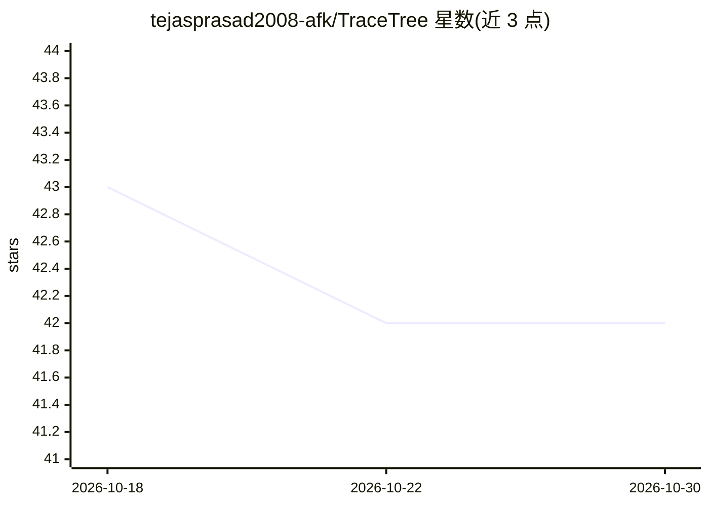

# tejasprasad2008-afk/TraceTree

⭐ 42 · Python · NOASSERTION · 推送 2026-10-01 · [GitHub](https://github.com/tejasprasad2008-afk/TraceTree) · [官网](https://tracetree-sigma.vercel.app/) · 个人维护

**运行时行为分析工具：沙箱追踪包安装的进程级联，检测供应链攻击**

安全分析工具：在 Docker 沙箱中执行 PyPI/npm 包、DMG、EXE 等目标，用 strace 追踪全部系统调用，解析后匹配 8 种行为签名（反弹 shell、容器逃逸、凭据窃取等）与 5 种时序模式，并以 NetworkX 构建有向行为图、RandomForest 模型输出恶意性判定。另含 MCP 服务器安全分析、macOS 应用隐私/离线审计（AX/CDP 自动探索 UI 并关联 socket 流量）、基于本地 LLM（Qwen-Coder）的 pre-commit 泄漏扫描等模块。面向开发与安全审查场景，提供 CLI 与本地 Workbench 仪表盘。限制：DMG/EXE 在 Linux 容器或 Wine 下运行，平台特定行为可能不可见。

## 筛选速览

| 维度 | 判定 | 备注 |
|---|---|---|
| AI 角色 | `ai-enhanced` | 去掉 AI 部分产品仍成立 |
| 许可风险 | `none` | NOASSERTION |
| 部署形态 | `desktop` | 安装包/桌面程序 |
| 模型依赖 | local-ok | 支持本地模型 |
| 硬件要求 | — | 无带数字的原话,不猜 |
| 安装摩擦 | `low` | 无编译、无系统依赖或容器化 |
| 成熟度 | — | 结构信号不足 |

## 能力要点

- Docker 沙箱断网执行 + strace 全量系统调用追踪
- 8 种行为签名 + 5 种时序模式 + 24 类 syscall 严重度加权
- NetworkX 行为图 + RandomForest/IsolationForest 异常检测
- MCP 服务器安全分析与 macOS 应用隐私/离线自动化审计

## 适用场景

- 安装依赖包前审查其运行时行为，拦截 typosquat 等供应链攻击
- 作为 agent/人工信任包安装前的审查门（导出 JSON/SARIF 行为回执）
- 审计桌面应用是否真实零遥测、本地执行
- 分析 MCP 服务器的安全风险

## 场景标签

`网络安全` · 领域:学习与行业

## 证据(README 行号)

> L24: 1. **Leg 1: Sandbox Isolation (The Trap)** — Executes targets in isolated Docker containers (or a high-performance 
> L53: 1. **Sandbox** — The target runs inside a Docker container. Network is dropped (`ip link set eth0 down`) before ins
> L27: 4. **Leg 4: ML Anomaly Detection (The Intuition)** — A custom-trained Random Forest model (trained on a small, repr

## 星数曲线

2026-10-18 43 → 2026-10-30 42（-1）

---
*卡片 v1 · prompt 1.4 · 生成 2026-10-25 · 置信度 mid · 依据 README sha `09e3a65d9933` · [字段定义](../../DATASET.md)*
