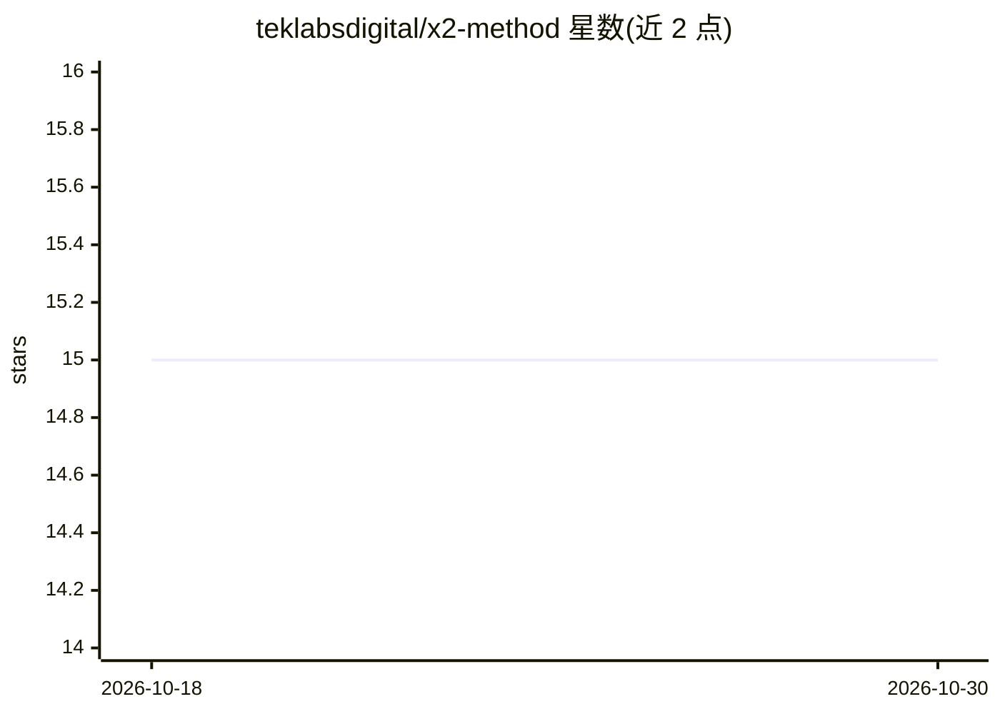

# teklabsdigital/x2-method

⭐ 15 · JavaScript · NOASSERTION · 推送 2026-08-06 · [GitHub](https://github.com/teklabsdigital/x2-method) · [官网](https://github.com/teklabsdigital/x2-method) · 组织维护

**面向 Claude Code 的 agentic 软件工程方法与技能插件**

X2 是一套以 AI agent 为施工方的软件工程方法，以 Claude Code 插件（技能集，命名空间 x2:）形式交付。机制为三分法：不可破坏的规则内置于自动检查（违反即构建失败），决策保留在人类持有的少量文档中，代码视为可再生产物。流程含三个人工关卡（批准故事、批准并锁定设计、验收审计报告），并用‘每切片人工回合数’度量自身成本，项目结束时以 x2:extract 挖掘日志反哺方法。提供 Node/React 与 .NET/React 两个内核版本。README 同时声明样本仅三个项目、无基线等限制。

## 筛选速览

| 维度 | 判定 | 备注 |
|---|---|---|
| AI 角色 | `ai-ecosystem` | LLM/agent 周边工具 |
| 许可风险 | `none` | NOASSERTION |
| 部署形态 | `None` |  |
| 模型依赖 | locked-api |  |
| 硬件要求 | — | 无带数字的原话,不猜 |
| 安装摩擦 | `medium` | 含编译或系统依赖之一 |
| 成熟度 | `idea` | |

## 能力要点

- 规则进机器：不变量内置于自动检查，违反即构建失败
- 三个人工关卡与‘green-but-wrong’防护，完成需第三方验证的审计报告
- 以人工回合数自我计分，x2:extract 提取缺陷与 churn 发现反哺方法
- 双内核版本（Node 24/Fastify 与 .NET 9/ASP.NET Core）各自发布符合性记录

## 适用场景

- 用 Claude Code 按切片从用户故事构建可运行的端到端应用
- 在 AI 代写代码的流程中保留人工决策点与强制规则
- 对 AI 构建过程按人工回合数记录并审计成本

## 场景标签

`编码 Agent` · 领域:编码与开发

## 证据(README 行号)

> L3: An agentic software engineering method: AI agents do the building, the build enforces the rules
> L108: You need Claude Code, because the skills are written for it, plus
> L128: Install the plugin once, from inside Claude Code:

## 星数曲线

2026-10-18 15 → 2026-10-30 15（+0）

---
*卡片 v1 · prompt 1.4 · 生成 2026-10-30 · 置信度 high · 依据 README sha `fc6c7a031caf` · [字段定义](../../DATASET.md)*
