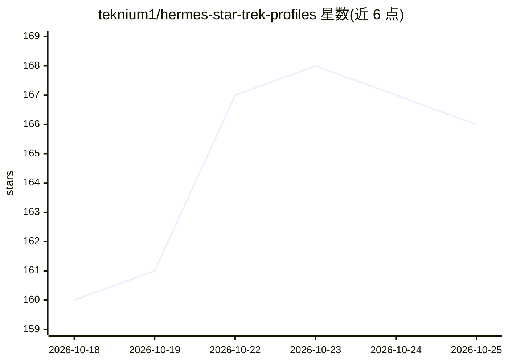

# teknium1/hermes-star-trek-profiles

⭐ 166 · Python · MIT · 推送 2026-07-13 · [GitHub](https://github.com/teknium1/hermes-star-trek-profiles) · 个人维护

**给 Hermes Agent 用户：68 个可安装的星际迷航角色人格配置**

面向 Hermes Agent 的人格（profile）分发集合：覆盖 TOS/TNG/DS9/Voyager 四部剧集共 68 个角色，每个角色是一个独立分发，包含 SOUL.md（身份、语气、盲点、压力行为等）、终端皮肤、provider 中立的 config.yaml 与 distribution.yaml。通过 manage.py 选择角色目录并交给 Hermes 原生安装器安装，不写入凭据、记忆或模型选择，更新时保留本地记忆与会话。声明为非官方同人作品，MIT 许可且不含原剧台词与图像素材。

## 筛选速览

| 维度 | 判定 | 备注 |
|---|---|---|
| AI 角色 | `ai-knowledge` | 知识聚合/清单类 |
| 许可风险 | `permissive` | MIT |
| 部署形态 | `None` |  |
| 模型依赖 | — | README 未给出锁定关系 |
| 硬件要求 | — | 无带数字的原话,不猜 |
| 安装摩擦 | `low` | 无编译、无系统依赖或容器化 |
| 成熟度 | — | 结构信号不足 |

## 能力要点

- 68 个角色 profile，每个含 SOUL.md、皮肤与 distribution.yaml
- manage.py 按需选择角色并复用 Hermes 原生安装器
- profile 不含凭据/记忆/模型选择，provider 中立
- 安装前打印每个 profile 载荷的 SHA-256，构建过程确定性可复现

## 适用场景

- 给 Hermes Agent 换装成特定角色的行为风格
- 按剧集浏览并批量安装多个角色人格
- 对比不同角色 profile 在同一任务上的行为差异

## 场景标签

`提示工程` · 领域:Agent 开发

## 证据(README 行号)

> L3: Star Trek Profiles for Hermes Agent: 68 installable profiles across TOS, TNG, Deep Space Nine, and Voyager
> L5: A collection of comprehensive, installable Hermes Agent personas inspired by characters from:
> L16: - A substantial `SOUL.md` covering identity, voice, worldview, operating method, strengths, blind spots, pressure b

## 星数曲线

2026-10-18 160 → 2026-10-25 166（+6）

---
*卡片 v1 · prompt 1.4 · 生成 2026-10-22 · 置信度 high · 依据 README sha `f90e1fce7ff4` · [字段定义](../../DATASET.md)*
