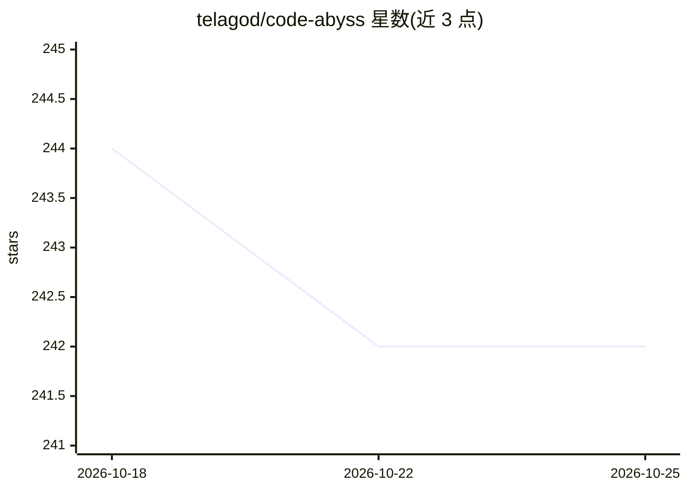

# telagod/code-abyss

⭐ 244 · JavaScript · MIT · 推送 2026-07-19 · [GitHub](https://github.com/telagod/code-abyss) · [官网](https://www.npmjs.com/package/code-abyss) · 个人维护 · 中文 README

**给 AI 编程 agent 安装可组合人设、工程判断内核与技能的配置框架**

面向 Claude Code、Codex CLI、Gemini CLI、OpenClaw 等编码 agent 的分层配置安装器：一条 npx 命令向 agent 注入人格（persona）、风格（style）与纪律内核（9 组工程判断 bundle，惰性路由调用）及 30 个技能（含 4 个原生安全领域、4073 行内容）。默认开启字符 Stop-hook 强制修正妥协话术，附人格行为评测脚本；v4.1 起提供技能自进化锻造。代码图能力由独立产品 abyss Rust CLI 承担（含 MCP server 与基准数据），npm 包本身不下载该二进制。多数 persona 首次使用时从 GitHub 拉取缓存。

## 筛选速览

| 维度 | 判定 | 备注 |
|---|---|---|
| AI 角色 | `ai-ecosystem` | LLM/agent 周边工具 |
| 许可风险 | `permissive` | MIT |
| 部署形态 | `library` | 以包/库形式分发 |
| 模型依赖 | — | README 未给出锁定关系 |
| 硬件要求 | — | 无带数字的原话,不猜 |
| 安装摩擦 | `low` | 无编译、无系统依赖或容器化 |
| 成熟度 | — | 结构信号不足 |

## 能力要点

- persona × style × 纪律内核的分层组合架构，内核惰性加载
- 30 个技能含 4 个原生安全领域（4073 行，威胁建模/IR/云供应链等）
- 默认字符 Stop-hook 拦截妥协性回复并可强制一轮修正
- 技能自进化：将重复工作流蒸馏为可发布技能（本地→项目→社区）

## 适用场景

- 给我的 Claude Code / Codex CLI 换上带安全背景的固定人格
- 让 agent 在多次会话间保持一致判断与工程纪律
- 为 agent 增加渗透测试、威胁建模等安全技能库
- 让 agent 通过 abyss CLI 获得调用图与影响分析能力

## 场景标签

`提示工程` `网络安全` · 领域:Agent 开发

## 证据(README 行号)

> L30: One command installs a layered runtime into your agent:
> L64: npx code-abyss@5.0.0-rc.1 -t claude -y                     # persona / skills / style + default enforcement + injec

## 星数曲线

2026-10-18 244 → 2026-10-25 242（-2）

---
*卡片 v1 · prompt 1.4 · 生成 2026-10-22 · 置信度 high · 依据 README sha `d1f16e5a4977` · [字段定义](../../DATASET.md)*
