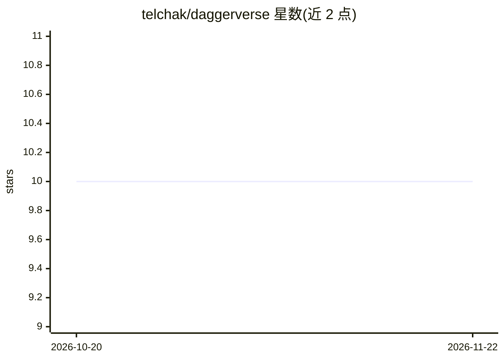

# telchak/daggerverse

⭐ 10 · Python · Apache-2.0 · 推送 2026-11-15 · [GitHub](https://github.com/telchak/daggerverse) · [官网](https://daggerverse.dev/search?author=telchak) · 个人维护

**面向 GCP CI/CD 的可复用 Dagger 模块与 AI 开发运维 Agent 集合**

以 Dagger 模块形式发布的 CI/CD 构件集合，覆盖 CalVer/SemVer 版本管理、GCP 认证（OIDC/Workload Identity Federation）、Artifact Registry 镜像操作、Cloud Run 与 Firebase 部署、Angular/Python 构建测试等；同时提供五个基于 Dagger LLM 支持的 AI Agent（Angular、Python、GCP 运维、Dagger 专项、规格驱动开发），通过 MCP 服务器扩展能力，支持 develop-github-issue 自动开 PR 与 --self-improve 上下文学习循环。模块面向 Dagger 1.0，通过 dagger module install 按模块独立版本安装。

## 筛选速览

| 维度 | 判定 | 备注 |
|---|---|---|
| AI 角色 | `ai-native` | 本体是模型或模型工具 |
| 许可风险 | `permissive` | Apache-2.0 |
| 部署形态 | `library` | 以包/库形式分发 |
| 模型依赖 | — | README 未给出锁定关系 |
| 硬件要求 | — | 无带数字的原话,不猜 |
| 安装摩擦 | `low` | 无编译、无系统依赖或容器化 |
| 成熟度 | — | 结构信号不足 |

## 能力要点

- 12 个独立 Dagger 模块：版本管理、GCP 认证与部署、Angular/Python 构建工具链
- 五个 AI Agent（Angie/Monty/Goose/Daggie/Speck），各有 assist/review/build/write-tests 等入口
- 通过 MCP 服务器接入 Angular CLI、gcloud、PyPI 查询等外部工具
- --self-improve 标志支持 Agent 会话间更新上下文文件（agent 专属 + 共享 AGENTS.md）

## 适用场景

- 在 Dagger CI/CD 流水线中复用 GCP 认证与 Cloud Run/Firebase 部署模块
- 用 Goose Agent 排查 Cloud Run 服务并检索 GCP 文档
- 用 Monty/Angie Agent 对 Python/Angular 项目做代码评审、写测试与升级
- 从 GitHub issue 自动生成规格、任务分解并开出 PR

## 场景标签

`编码 Agent` `代码审查` · 领域:编码与开发

## 证据(README 行号)

> L9: A collection of small, independent, reusable Dagger modules and AI agents for CI/CD pipelines. Built with the Dagger
> L32: AI-powered development and operations agents built with Dagger's LLM support. Each agent provides specialized entry

## 星数曲线

2026-10-20 10 → 2026-11-22 10（+0）

---
*卡片 v1 · prompt 1.4 · 生成 2026-11-19 · 置信度 low · 依据 README sha `89ab5268dda6` · [字段定义](../../DATASET.md)*
